# Mapa de relacionamentos do banco de dados

> Gerado em 2026-10-19 por `npm run db:docs -- --write` a partir do catálogo do PostgreSQL de **desenvolvimento** (PostgreSQL 18.6 on x86_64-windows), sem ler dado de negócio. Complementa [BANCO_DE_DADOS](BANCO_DE_DADOS.md) (por tabela) e [REVISAO_BANCO_PENDENCIAS](REVISAO_BANCO_PENDENCIAS.md) (riscos).

## 1. Como ler

- **FK declarada** = chave estrangeira real no banco (ao apagar o pai: ver a regra).
- **Relação lógica (sem FK)** = coluna `…Id` cujo nome aponta um modelo, mas **sem** chave estrangeira — a convenção do projeto para quase todo dado de empresa/filial (o isolamento vem da **RLS**, não de FK). É **inferida pelo nome da coluna** (heurística) e deve ser conferida; o que não resolve para um modelo aparece em §6.
- Contagens: **113 tabelas**, **269 FKs declaradas**, **83 relações lógicas sem FK** inferidas (fora `companyId`/`branchId`), 59 colunas `…Id` sem alvo inferido.

## 2. Cadeias principais (empresa → filial → usuário → catálogo → estoque → venda → caixa → compra → pagamento)

Cada linha é verificada contra o catálogo: **FK** (declarada), **lógica** (coluna existe, sem FK) ou **coluna não encontrada**.

| Módulo | Filho.coluna | → Pai | Situação | Ao apagar o pai |
|---|---|---|---|---|
| Empresa/filial | `branches.companyId` | `companies` | **FK** | RESTRICT |
| Empresa/filial | `licenses.companyId` | `companies` | **FK** | RESTRICT |
| Empresa/filial | `invoices.companyId` | `companies` | **FK** | RESTRICT |
| Usuários | `users.companyId` | `companies` | **FK** | RESTRICT |
| Usuários | `users.branchId` | `branches` | **FK** | SET NULL |
| Usuários | `user_roles.userId` | `users` | **FK** | CASCADE |
| Usuários | `user_roles.roleId` | `roles` | **FK** | CASCADE |
| Usuários | `role_permissions.roleId` | `roles` | **FK** | CASCADE |
| Usuários | `role_permissions.permissionId` | `permissions` | **FK** | CASCADE |
| Usuários | `refresh_tokens.userId` | `users` | **FK** | CASCADE |
| Produtos | `products.categoryId` | `categories` | lógica (sem FK) | — |
| Produtos | `products.companyId` | `companies` | **FK** | RESTRICT |
| Produtos | `product_barcodes.productId` | `products` | lógica (sem FK) | — |
| Produtos | `product_images.productId` | `products` | lógica (sem FK) | — |
| Produtos | `combo_items.productId` | `products` | **FK** | CASCADE |
| Estoque | `stock_movements.productId` | `products` | lógica (sem FK) | — |
| Estoque | `stock_movements.branchId` | `branches` | lógica (sem FK) | — |
| Estoque | `stock_movements.userId` | `users` | lógica (sem FK) | — |
| Estoque | `stock_reservations.productId` | `products` | lógica (sem FK) | — |
| Estoque | `transfer_items.transferId` | `transfers` | **FK** | RESTRICT |
| Estoque | `transfer_items.productId` | `products` | **FK** | RESTRICT |
| Estoque | `inventory_counts.inventoryId` | `inventories` | **FK** | RESTRICT |
| Estoque | `inventory_counts.productId` | `products` | **FK** | RESTRICT |
| Estoque | `damage_records.productId` | `products` | lógica (sem FK) | — |
| Vendas | `sales.customerId` | `customers` | lógica (sem FK) | — |
| Vendas | `sales.userId` | `users` | lógica (sem FK) | — |
| Vendas | `sales.branchId` | `branches` | lógica (sem FK) | — |
| Vendas | `sales.cashRegisterId` | `cash_registers` | lógica (sem FK) | — |
| Vendas | `sale_items.saleId` | `sales` | **FK** | RESTRICT |
| Vendas | `sale_items.productId` | `products` | **FK** | RESTRICT |
| Caixa | `cash_registers.branchId` | `branches` | lógica (sem FK) | — |
| Caixa | `cash_registers.userId` | `users` | lógica (sem FK) | — |
| Caixa | `cash_movements.cashRegisterId` | `cash_registers` | **FK** | RESTRICT |
| Pagamentos | `payments.saleId` | `sales` | lógica (sem FK) | — |
| Pagamentos | `tef_payments.saleId` | `sales` | lógica (sem FK) | — |
| Pagamentos | `payment_exceptions.paymentId` | `payments` | lógica (sem FK) | — |
| Compras | `purchase_orders.supplierId` | `suppliers` | lógica (sem FK) | — |
| Compras | `purchase_order_items.purchaseOrderId` | `purchase_orders` | **FK** | RESTRICT |
| Compras | `purchase_order_items.productId` | `products` | **FK** | RESTRICT |
| Compras | `supplier_returns.supplierId` | `suppliers` | lógica (sem FK) | — |
| Compras | `supplier_return_items.returnId` | `supplier_returns` | lógica (sem FK) | — |
| Financeiro | `accounts_receivable.customerId` | `customers` | lógica (sem FK) | — |
| Financeiro | `accounts_payable.supplierId` | `suppliers` | lógica (sem FK) | — |
| Financeiro | `collection_attempts.receivableId` | `accounts_receivable` | lógica (sem FK) | — |
| Oficina | `service_orders.customerId` | `customers` | lógica (sem FK) | — |
| Oficina | `service_orders.motorcycleId` | `motorcycles` | lógica (sem FK) | — |
| Oficina | `service_order_items.serviceOrderId` | `service_orders` | **FK** | RESTRICT |
| Oficina | `motorcycles.customerId` | `customers` | lógica (sem FK) | — |
| Fiscal | `fiscal_documents.saleId` | `sales` | lógica (sem FK) | — |
| Fiscal | `fiscal_documents.serviceOrderId` | `service_orders` | lógica (sem FK) | — |
| Canais | `external_orders.channelId` | `sales_channels` | lógica (sem FK) | — |
| Canais | `external_order_items.orderId` | `external_orders` | lógica (sem FK) | — |
| Canais | `channel_product_links.productId` | `products` | lógica (sem FK) | — |
| Privacidade (subjectId é polimórfico, conforme subjectType) | `privacy_requests.subjectId` | `customers` | lógica (sem FK) | — |
| Equipamento | `device_sessions.deviceId` | `devices` | **FK** | CASCADE |

Linhas "coluna não encontrada": **0** (nome da coluna difere do esperado; ver a tabela em [BANCO_DE_DADOS](BANCO_DE_DADOS.md)).

## 3. Chaves estrangeiras declaradas (todas)

Total **269**. Por regra ao apagar o pai: RESTRICT 239 · CASCADE 24 · SET NULL 6.

| Domínio (filho) | Filho.coluna | → Pai.coluna | Ao apagar | Ao atualizar |
|---|---|---|---|---|
| Plataforma, identidade e acesso | `activations.deviceId` | `devices.id` | CASCADE | CASCADE |
| Plataforma, identidade e acesso | `activations.licenseId` | `licenses.id` | CASCADE | CASCADE |
| Plataforma, identidade e acesso | `activations.userId` | `users.id` | CASCADE | CASCADE |
| Plataforma, identidade e acesso | `branches.companyId` | `companies.id` | RESTRICT | CASCADE |
| Plataforma, identidade e acesso | `company_module_settings.companyId, branchId` | `branches.companyId, id` | RESTRICT | CASCADE |
| Plataforma, identidade e acesso | `company_module_settings.companyId` | `companies.id` | RESTRICT | CASCADE |
| Plataforma, identidade e acesso | `device_sessions.companyId, branchId` | `branches.companyId, id` | RESTRICT | CASCADE |
| Plataforma, identidade e acesso | `device_sessions.companyId` | `companies.id` | RESTRICT | CASCADE |
| Plataforma, identidade e acesso | `device_sessions.companyId, userId` | `users.companyId, id` | CASCADE | CASCADE |
| Plataforma, identidade e acesso | `device_sessions.deviceId` | `devices.id` | CASCADE | CASCADE |
| Plataforma, identidade e acesso | `devices.licenseId` | `licenses.id` | CASCADE | CASCADE |
| Plataforma, identidade e acesso | `invoices.companyId` | `companies.id` | RESTRICT | CASCADE |
| Plataforma, identidade e acesso | `invoices.companyId, purchaseOrderId` | `purchase_orders.companyId, id` | RESTRICT | CASCADE |
| Plataforma, identidade e acesso | `invoices.companyId, supplierId` | `suppliers.companyId, id` | RESTRICT | CASCADE |
| Plataforma, identidade e acesso | `licenses.companyId` | `companies.id` | RESTRICT | CASCADE |
| Plataforma, identidade e acesso | `permissions.companyId` | `companies.id` | CASCADE | CASCADE |
| Plataforma, identidade e acesso | `refresh_tokens.companyId` | `companies.id` | CASCADE | CASCADE |
| Plataforma, identidade e acesso | `refresh_tokens.companyId, userId` | `users.companyId, id` | CASCADE | CASCADE |
| Plataforma, identidade e acesso | `refresh_tokens.userId` | `users.id` | CASCADE | CASCADE |
| Plataforma, identidade e acesso | `role_permissions.permissionId` | `permissions.id` | CASCADE | CASCADE |
| Plataforma, identidade e acesso | `role_permissions.roleId` | `roles.id` | CASCADE | CASCADE |
| Plataforma, identidade e acesso | `roles.companyId` | `companies.id` | CASCADE | CASCADE |
| Plataforma, identidade e acesso | `user_roles.roleId` | `roles.id` | CASCADE | CASCADE |
| Plataforma, identidade e acesso | `user_roles.userId` | `users.id` | CASCADE | CASCADE |
| Plataforma, identidade e acesso | `users.branchId` | `branches.id` | SET NULL | CASCADE |
| Plataforma, identidade e acesso | `users.companyId` | `companies.id` | RESTRICT | CASCADE |
| Auditoria, observabilidade e operação | `audit_logs.companyId` | `companies.id` | RESTRICT | CASCADE |
| Auditoria, observabilidade e operação | `audit_logs.userId` | `users.id` | SET NULL | CASCADE |
| Auditoria, observabilidade e operação | `import_batches.companyId, branchId` | `branches.companyId, id` | RESTRICT | CASCADE |
| Auditoria, observabilidade e operação | `import_batches.companyId` | `companies.id` | RESTRICT | CASCADE |
| Auditoria, observabilidade e operação | `import_batches.companyId, userId` | `users.companyId, id` | RESTRICT | CASCADE |
| Auditoria, observabilidade e operação | `privacy_requests.companyId` | `companies.id` | RESTRICT | CASCADE |
| Políticas e calendário | `agenda_unavailabilities.companyId, branchId` | `branches.companyId, id` | RESTRICT | CASCADE |
| Políticas e calendário | `agenda_unavailabilities.companyId` | `companies.id` | RESTRICT | CASCADE |
| Políticas e calendário | `business_calendar_exceptions.companyId, branchId` | `branches.companyId, id` | RESTRICT | CASCADE |
| Políticas e calendário | `business_calendar_exceptions.companyId` | `companies.id` | RESTRICT | CASCADE |
| Políticas e calendário | `business_hours.companyId, branchId` | `branches.companyId, id` | RESTRICT | CASCADE |
| Políticas e calendário | `business_hours.companyId` | `companies.id` | RESTRICT | CASCADE |
| Políticas e calendário | `installment_policies.companyId, branchId` | `branches.companyId, id` | RESTRICT | CASCADE |
| Políticas e calendário | `installment_policies.companyId` | `companies.id` | CASCADE | CASCADE |
| Políticas e calendário | `payment_settings.companyId, branchId` | `branches.companyId, id` | RESTRICT | CASCADE |
| Políticas e calendário | `payment_settings.companyId` | `companies.id` | RESTRICT | CASCADE |
| Políticas e calendário | `policy_changes.companyId, branchId` | `branches.companyId, id` | RESTRICT | CASCADE |
| Políticas e calendário | `policy_changes.companyId` | `companies.id` | RESTRICT | CASCADE |
| Políticas e calendário | `policy_settings.companyId, branchId` | `branches.companyId, id` | RESTRICT | CASCADE |
| Políticas e calendário | `policy_settings.companyId` | `companies.id` | RESTRICT | CASCADE |
| Catálogo e estoque | `categories.companyId` | `companies.id` | RESTRICT | CASCADE |
| Catálogo e estoque | `categories.companyId, parentId` | `categories.companyId, id` | RESTRICT | CASCADE |
| Catálogo e estoque | `combo_items.comboId` | `products.id` | CASCADE | CASCADE |
| Catálogo e estoque | `combo_items.productId` | `products.id` | CASCADE | CASCADE |
| Catálogo e estoque | `damage_records.companyId, branchId` | `branches.companyId, id` | RESTRICT | CASCADE |
| Catálogo e estoque | `damage_records.companyId` | `companies.id` | RESTRICT | CASCADE |
| Catálogo e estoque | `damage_records.companyId, productId` | `products.companyId, id` | RESTRICT | CASCADE |
| Catálogo e estoque | `inventories.companyId, branchId` | `branches.companyId, id` | RESTRICT | CASCADE |
| Catálogo e estoque | `inventories.companyId` | `companies.id` | RESTRICT | CASCADE |
| Catálogo e estoque | `inventory_counts.inventoryId` | `inventories.id` | RESTRICT | CASCADE |
| Catálogo e estoque | `inventory_counts.productId` | `products.id` | RESTRICT | CASCADE |
| Catálogo e estoque | `product_barcodes.companyId` | `companies.id` | CASCADE | CASCADE |
| Catálogo e estoque | `product_barcodes.companyId, productId` | `products.companyId, id` | RESTRICT | CASCADE |
| Catálogo e estoque | `product_images.companyId` | `companies.id` | CASCADE | CASCADE |
| Catálogo e estoque | `product_images.companyId, productId` | `products.companyId, id` | CASCADE | CASCADE |
| Catálogo e estoque | `products.companyId, branchId` | `branches.companyId, id` | RESTRICT | CASCADE |
| Catálogo e estoque | `products.companyId, categoryId` | `categories.companyId, id` | RESTRICT | CASCADE |
| Catálogo e estoque | `products.companyId` | `companies.id` | RESTRICT | CASCADE |
| Catálogo e estoque | `purchase_order_items.productId` | `products.id` | RESTRICT | CASCADE |
| Catálogo e estoque | `purchase_order_items.purchaseOrderId` | `purchase_orders.id` | RESTRICT | CASCADE |
| Catálogo e estoque | `purchase_orders.companyId, branchId` | `branches.companyId, id` | RESTRICT | CASCADE |
| Catálogo e estoque | `purchase_orders.companyId` | `companies.id` | RESTRICT | CASCADE |
| Catálogo e estoque | `purchase_orders.companyId, supplierId` | `suppliers.companyId, id` | RESTRICT | CASCADE |
| Catálogo e estoque | `stock_movements.companyId, branchId` | `branches.companyId, id` | RESTRICT | CASCADE |
| Catálogo e estoque | `stock_movements.companyId` | `companies.id` | RESTRICT | CASCADE |
| Catálogo e estoque | `stock_movements.companyId, productId` | `products.companyId, id` | RESTRICT | CASCADE |
| Catálogo e estoque | `stock_movements.companyId, userId` | `users.companyId, id` | RESTRICT | CASCADE |
| Catálogo e estoque | `stock_reservations.companyId, branchId` | `branches.companyId, id` | RESTRICT | CASCADE |
| Catálogo e estoque | `stock_reservations.companyId, channelId` | `sales_channels.companyId, id` | RESTRICT | CASCADE |
| Catálogo e estoque | `stock_reservations.companyId` | `companies.id` | RESTRICT | CASCADE |
| Catálogo e estoque | `stock_reservations.companyId, orderId` | `external_orders.companyId, id` | RESTRICT | CASCADE |
| Catálogo e estoque | `stock_reservations.companyId, productId` | `products.companyId, id` | RESTRICT | CASCADE |
| Catálogo e estoque | `supplier_return_events.companyId, branchId` | `branches.companyId, id` | RESTRICT | CASCADE |
| Catálogo e estoque | `supplier_return_events.companyId` | `companies.id` | RESTRICT | CASCADE |
| Catálogo e estoque | `supplier_return_events.companyId, returnId` | `supplier_returns.companyId, id` | RESTRICT | CASCADE |
| Catálogo e estoque | `supplier_return_events.companyId, userId` | `users.companyId, id` | RESTRICT | CASCADE |
| Catálogo e estoque | `supplier_return_items.companyId, branchId` | `branches.companyId, id` | RESTRICT | CASCADE |
| Catálogo e estoque | `supplier_return_items.companyId, damageRecordId` | `damage_records.companyId, id` | RESTRICT | CASCADE |
| Catálogo e estoque | `supplier_return_items.companyId` | `companies.id` | RESTRICT | CASCADE |
| Catálogo e estoque | `supplier_return_items.companyId, productId` | `products.companyId, id` | RESTRICT | CASCADE |
| Catálogo e estoque | `supplier_return_items.companyId, returnId` | `supplier_returns.companyId, id` | RESTRICT | CASCADE |
| Catálogo e estoque | `supplier_returns.companyId, branchId` | `branches.companyId, id` | RESTRICT | CASCADE |
| Catálogo e estoque | `supplier_returns.companyId` | `companies.id` | RESTRICT | CASCADE |
| Catálogo e estoque | `supplier_returns.companyId, purchaseOrderId` | `purchase_orders.companyId, id` | RESTRICT | CASCADE |
| Catálogo e estoque | `supplier_returns.companyId, supplierId` | `suppliers.companyId, id` | RESTRICT | CASCADE |
| Catálogo e estoque | `suppliers.companyId` | `companies.id` | RESTRICT | CASCADE |
| Catálogo e estoque | `transfer_items.productId` | `products.id` | RESTRICT | CASCADE |
| Catálogo e estoque | `transfer_items.transferId` | `transfers.id` | RESTRICT | CASCADE |
| Catálogo e estoque | `transfers.companyId` | `companies.id` | RESTRICT | CASCADE |
| Catálogo e estoque | `transfers.companyId, fromBranchId` | `branches.companyId, id` | RESTRICT | CASCADE |
| Catálogo e estoque | `transfers.companyId, toBranchId` | `branches.companyId, id` | RESTRICT | CASCADE |
| Clientes, veículos e pós-venda | `appointment_events.appointmentId` | `appointments.id` | RESTRICT | CASCADE |
| Clientes, veículos e pós-venda | `appointments.companyId, branchId` | `branches.companyId, id` | RESTRICT | CASCADE |
| Clientes, veículos e pós-venda | `appointments.companyId, customerId` | `customers.companyId, id` | RESTRICT | CASCADE |
| Clientes, veículos e pós-venda | `appointments.companyId` | `companies.id` | RESTRICT | CASCADE |
| Clientes, veículos e pós-venda | `appointments.companyId, followUpId` | `follow_ups.companyId, id` | RESTRICT | CASCADE |
| Clientes, veículos e pós-venda | `appointments.companyId, motorcycleId` | `motorcycles.companyId, id` | RESTRICT | CASCADE |
| Clientes, veículos e pós-venda | `customers.companyId` | `companies.id` | RESTRICT | CASCADE |
| Clientes, veículos e pós-venda | `follow_up_events.followUpId` | `follow_ups.id` | RESTRICT | CASCADE |
| Clientes, veículos e pós-venda | `follow_ups.companyId, branchId` | `branches.companyId, id` | RESTRICT | CASCADE |
| Clientes, veículos e pós-venda | `follow_ups.companyId, customerId` | `customers.companyId, id` | RESTRICT | CASCADE |
| Clientes, veículos e pós-venda | `follow_ups.companyId` | `companies.id` | RESTRICT | CASCADE |
| Clientes, veículos e pós-venda | `follow_ups.companyId, motorcycleId` | `motorcycles.companyId, id` | RESTRICT | CASCADE |
| Clientes, veículos e pós-venda | `follow_ups.companyId, revisionId` | `revisions.companyId, id` | RESTRICT | CASCADE |
| Clientes, veículos e pós-venda | `motorcycles.companyId, customerId` | `customers.companyId, id` | RESTRICT | CASCADE |
| Clientes, veículos e pós-venda | `motorcycles.companyId` | `companies.id` | RESTRICT | CASCADE |
| Clientes, veículos e pós-venda | `revisions.companyId, branchId` | `branches.companyId, id` | RESTRICT | CASCADE |
| Clientes, veículos e pós-venda | `revisions.companyId, customerId` | `customers.companyId, id` | RESTRICT | CASCADE |
| Clientes, veículos e pós-venda | `revisions.companyId` | `companies.id` | RESTRICT | CASCADE |
| Clientes, veículos e pós-venda | `revisions.companyId, motorcycleId` | `motorcycles.companyId, id` | RESTRICT | CASCADE |
| Clientes, veículos e pós-venda | `revisions.companyId, serviceOrderId` | `service_orders.companyId, id` | RESTRICT | CASCADE |
| Vendas, caixa e pagamento | `cash_movements.cashRegisterId` | `cash_registers.id` | RESTRICT | CASCADE |
| Vendas, caixa e pagamento | `cash_registers.companyId, branchId` | `branches.companyId, id` | RESTRICT | CASCADE |
| Vendas, caixa e pagamento | `cash_registers.companyId` | `companies.id` | RESTRICT | CASCADE |
| Vendas, caixa e pagamento | `cash_registers.companyId, userId` | `users.companyId, id` | RESTRICT | CASCADE |
| Vendas, caixa e pagamento | `discount_events.companyId, branchId` | `branches.companyId, id` | RESTRICT | CASCADE |
| Vendas, caixa e pagamento | `discount_events.companyId` | `companies.id` | RESTRICT | CASCADE |
| Vendas, caixa e pagamento | `discount_events.companyId, quoteId` | `quotes.companyId, id` | RESTRICT | CASCADE |
| Vendas, caixa e pagamento | `discount_events.companyId, saleId` | `sales.companyId, id` | RESTRICT | CASCADE |
| Vendas, caixa e pagamento | `discount_events.companyId, serviceOrderId` | `service_orders.companyId, id` | RESTRICT | CASCADE |
| Vendas, caixa e pagamento | `discount_rules.companyId` | `companies.id` | RESTRICT | CASCADE |
| Vendas, caixa e pagamento | `partners.companyId, branchId` | `branches.companyId, id` | RESTRICT | CASCADE |
| Vendas, caixa e pagamento | `partners.companyId` | `companies.id` | CASCADE | CASCADE |
| Vendas, caixa e pagamento | `payment_exceptions.companyId, branchId` | `branches.companyId, id` | RESTRICT | CASCADE |
| Vendas, caixa e pagamento | `payment_exceptions.companyId` | `companies.id` | RESTRICT | CASCADE |
| Vendas, caixa e pagamento | `payment_exceptions.companyId, paymentId` | `payments.companyId, id` | RESTRICT | CASCADE |
| Vendas, caixa e pagamento | `payment_exceptions.companyId, saleId` | `sales.companyId, id` | RESTRICT | CASCADE |
| Vendas, caixa e pagamento | `payments.companyId, agreementCompanyId` | `agreement_companies.companyId, id` | RESTRICT | CASCADE |
| Vendas, caixa e pagamento | `payments.companyId, employeeAgreementId` | `employee_agreements.companyId, id` | RESTRICT | CASCADE |
| Vendas, caixa e pagamento | `payments.companyId` | `companies.id` | RESTRICT | CASCADE |
| Vendas, caixa e pagamento | `payments.companyId, saleId` | `sales.companyId, id` | RESTRICT | CASCADE |
| Vendas, caixa e pagamento | `sale_items.productId` | `products.id` | RESTRICT | CASCADE |
| Vendas, caixa e pagamento | `sale_items.saleId` | `sales.id` | RESTRICT | CASCADE |
| Vendas, caixa e pagamento | `sales.companyId, branchId` | `branches.companyId, id` | RESTRICT | CASCADE |
| Vendas, caixa e pagamento | `sales.companyId, cashRegisterId` | `cash_registers.companyId, id` | RESTRICT | CASCADE |
| Vendas, caixa e pagamento | `sales.companyId, channelId` | `sales_channels.companyId, id` | RESTRICT | CASCADE |
| Vendas, caixa e pagamento | `sales.companyId, customerId` | `customers.companyId, id` | RESTRICT | CASCADE |
| Vendas, caixa e pagamento | `sales.companyId` | `companies.id` | RESTRICT | CASCADE |
| Vendas, caixa e pagamento | `sales.companyId, userId` | `users.companyId, id` | RESTRICT | CASCADE |
| Vendas, caixa e pagamento | `sales.partnerId` | `partners.id` | SET NULL | CASCADE |
| Vendas, caixa e pagamento | `tef_payments.companyId` | `companies.id` | RESTRICT | CASCADE |
| Vendas, caixa e pagamento | `tef_payments.companyId, paymentId` | `payments.companyId, id` | RESTRICT | CASCADE |
| Vendas, caixa e pagamento | `tef_payments.companyId, saleId` | `sales.companyId, id` | RESTRICT | CASCADE |
| Vendas, caixa e pagamento | `tef_payments.companyId, serviceOrderId` | `service_orders.companyId, id` | RESTRICT | CASCADE |
| Financeiro e convênios | `accounts_payable.companyId, branchId` | `branches.companyId, id` | RESTRICT | CASCADE |
| Financeiro e convênios | `accounts_payable.companyId` | `companies.id` | RESTRICT | CASCADE |
| Financeiro e convênios | `accounts_payable.companyId, supplierId` | `suppliers.companyId, id` | RESTRICT | CASCADE |
| Financeiro e convênios | `accounts_receivable.companyId, agreementCompanyId` | `agreement_companies.companyId, id` | RESTRICT | CASCADE |
| Financeiro e convênios | `accounts_receivable.companyId, branchId` | `branches.companyId, id` | RESTRICT | CASCADE |
| Financeiro e convênios | `accounts_receivable.companyId, customerId` | `customers.companyId, id` | RESTRICT | CASCADE |
| Financeiro e convênios | `accounts_receivable.companyId, employeeAgreementId` | `employee_agreements.companyId, id` | RESTRICT | CASCADE |
| Financeiro e convênios | `accounts_receivable.companyId` | `companies.id` | RESTRICT | CASCADE |
| Financeiro e convênios | `agreement_companies.companyId, branchId` | `branches.companyId, id` | RESTRICT | CASCADE |
| Financeiro e convênios | `agreement_companies.companyId` | `companies.id` | RESTRICT | CASCADE |
| Financeiro e convênios | `collection_attempts.companyId, agreementCompanyId` | `agreement_companies.companyId, id` | RESTRICT | CASCADE |
| Financeiro e convênios | `collection_attempts.companyId, branchId` | `branches.companyId, id` | RESTRICT | CASCADE |
| Financeiro e convênios | `collection_attempts.companyId` | `companies.id` | RESTRICT | CASCADE |
| Financeiro e convênios | `collection_attempts.companyId, receivableId` | `accounts_receivable.companyId, id` | RESTRICT | CASCADE |
| Financeiro e convênios | `commission_rules.companyId` | `companies.id` | RESTRICT | CASCADE |
| Financeiro e convênios | `employee_agreement_charges.companyId, agreementId` | `employee_agreements.companyId, id` | RESTRICT | CASCADE |
| Financeiro e convênios | `employee_agreement_charges.companyId, branchId` | `branches.companyId, id` | RESTRICT | CASCADE |
| Financeiro e convênios | `employee_agreement_charges.companyId` | `companies.id` | RESTRICT | CASCADE |
| Financeiro e convênios | `employee_agreement_charges.companyId, paymentId` | `payments.companyId, id` | RESTRICT | CASCADE |
| Financeiro e convênios | `employee_agreement_charges.companyId, saleId` | `sales.companyId, id` | RESTRICT | CASCADE |
| Financeiro e convênios | `employee_agreements.companyId, branchId` | `branches.companyId, id` | RESTRICT | CASCADE |
| Financeiro e convênios | `employee_agreements.companyId, customerId` | `customers.companyId, id` | RESTRICT | CASCADE |
| Financeiro e convênios | `employee_agreements.companyId` | `companies.id` | RESTRICT | CASCADE |
| Financeiro e convênios | `employee_agreements.companyId, userId` | `users.companyId, id` | RESTRICT | CASCADE |
| Financeiro e convênios | `employee_payroll_deductions.companyId, branchId` | `branches.companyId, id` | RESTRICT | CASCADE |
| Financeiro e convênios | `employee_payroll_deductions.companyId, chargeId` | `employee_agreement_charges.companyId, id` | RESTRICT | CASCADE |
| Financeiro e convênios | `employee_payroll_deductions.companyId` | `companies.id` | RESTRICT | CASCADE |
| Financeiro e convênios | `mechanic_commissions.companyId` | `companies.id` | RESTRICT | CASCADE |
| Financeiro e convênios | `mechanic_commissions.companyId, serviceOrderId` | `service_orders.companyId, id` | RESTRICT | CASCADE |
| Oficina | `quote_events.companyId, branchId` | `branches.companyId, id` | RESTRICT | CASCADE |
| Oficina | `quote_events.companyId` | `companies.id` | RESTRICT | CASCADE |
| Oficina | `quote_events.companyId, quoteId` | `quotes.companyId, id` | RESTRICT | CASCADE |
| Oficina | `quote_items.quoteVersionId` | `quote_versions.id` | RESTRICT | CASCADE |
| Oficina | `quote_versions.quoteId` | `quotes.id` | RESTRICT | CASCADE |
| Oficina | `quotes.companyId, branchId` | `branches.companyId, id` | RESTRICT | CASCADE |
| Oficina | `quotes.companyId, customerId` | `customers.companyId, id` | RESTRICT | CASCADE |
| Oficina | `quotes.companyId` | `companies.id` | RESTRICT | CASCADE |
| Oficina | `quotes.companyId, motorcycleId` | `motorcycles.companyId, id` | RESTRICT | CASCADE |
| Oficina | `service_order_items.productId` | `products.id` | SET NULL | CASCADE |
| Oficina | `service_order_items.serviceOrderId` | `service_orders.id` | RESTRICT | CASCADE |
| Oficina | `service_order_status_history.serviceOrderId` | `service_orders.id` | RESTRICT | CASCADE |
| Oficina | `service_order_warranties.companyId, branchId` | `branches.companyId, id` | RESTRICT | CASCADE |
| Oficina | `service_order_warranties.companyId, customerId` | `customers.companyId, id` | RESTRICT | CASCADE |
| Oficina | `service_order_warranties.companyId` | `companies.id` | RESTRICT | CASCADE |
| Oficina | `service_order_warranties.companyId, motorcycleId` | `motorcycles.companyId, id` | RESTRICT | CASCADE |
| Oficina | `service_order_warranties.companyId, serviceOrderId` | `service_orders.companyId, id` | RESTRICT | CASCADE |
| Oficina | `service_orders.companyId, branchId` | `branches.companyId, id` | RESTRICT | CASCADE |
| Oficina | `service_orders.companyId, customerId` | `customers.companyId, id` | RESTRICT | CASCADE |
| Oficina | `service_orders.companyId` | `companies.id` | RESTRICT | CASCADE |
| Oficina | `service_orders.companyId, motorcycleId` | `motorcycles.companyId, id` | RESTRICT | CASCADE |
| Oficina | `service_orders.mechanicId` | `users.id` | SET NULL | CASCADE |
| Oficina | `service_orders.quoteVersionId` | `quote_versions.id` | SET NULL | CASCADE |
| Oficina | `vehicle_entry_checklist_items.checklistId` | `vehicle_entry_checklists.id` | RESTRICT | CASCADE |
| Oficina | `vehicle_entry_checklists.companyId` | `companies.id` | RESTRICT | CASCADE |
| Oficina | `vehicle_entry_checklists.companyId, motorcycleId` | `motorcycles.companyId, id` | RESTRICT | CASCADE |
| Oficina | `vehicle_entry_checklists.companyId, serviceOrderId` | `service_orders.companyId, id` | RESTRICT | CASCADE |
| Oficina | `warranty_claims.companyId, branchId` | `branches.companyId, id` | RESTRICT | CASCADE |
| Oficina | `warranty_claims.companyId` | `companies.id` | RESTRICT | CASCADE |
| Oficina | `warranty_claims.companyId, newServiceOrderId` | `service_orders.companyId, id` | RESTRICT | CASCADE |
| Oficina | `warranty_claims.companyId, serviceOrderId` | `service_orders.companyId, id` | RESTRICT | CASCADE |
| Oficina | `warranty_claims.companyId, warrantyId` | `service_order_warranties.companyId, id` | RESTRICT | CASCADE |
| Fiscal | `fiscal_configs.companyId, branchId` | `branches.companyId, id` | RESTRICT | CASCADE |
| Fiscal | `fiscal_configs.companyId` | `companies.id` | RESTRICT | CASCADE |
| Fiscal | `fiscal_documents.companyId, branchId` | `branches.companyId, id` | RESTRICT | CASCADE |
| Fiscal | `fiscal_documents.companyId` | `companies.id` | RESTRICT | CASCADE |
| Fiscal | `fiscal_documents.companyId, saleId` | `sales.companyId, id` | RESTRICT | CASCADE |
| Fiscal | `fiscal_documents.companyId, serviceOrderId` | `service_orders.companyId, id` | RESTRICT | CASCADE |
| Canais e integração | `channel_api_credentials.companyId, branchId` | `branches.companyId, id` | RESTRICT | CASCADE |
| Canais e integração | `channel_api_credentials.companyId, channelId` | `sales_channels.companyId, id` | RESTRICT | CASCADE |
| Canais e integração | `channel_api_credentials.companyId` | `companies.id` | RESTRICT | CASCADE |
| Canais e integração | `channel_events.companyId, branchId` | `branches.companyId, id` | RESTRICT | CASCADE |
| Canais e integração | `channel_events.companyId, channelId` | `sales_channels.companyId, id` | RESTRICT | CASCADE |
| Canais e integração | `channel_events.companyId` | `companies.id` | RESTRICT | CASCADE |
| Canais e integração | `channel_inbound_events.companyId, branchId` | `branches.companyId, id` | RESTRICT | CASCADE |
| Canais e integração | `channel_inbound_events.companyId, channelId` | `sales_channels.companyId, id` | RESTRICT | CASCADE |
| Canais e integração | `channel_inbound_events.companyId` | `companies.id` | RESTRICT | CASCADE |
| Canais e integração | `channel_outbox.companyId, branchId` | `branches.companyId, id` | RESTRICT | CASCADE |
| Canais e integração | `channel_outbox.companyId, channelId` | `sales_channels.companyId, id` | RESTRICT | CASCADE |
| Canais e integração | `channel_outbox.companyId` | `companies.id` | RESTRICT | CASCADE |
| Canais e integração | `channel_product_links.companyId, branchId` | `branches.companyId, id` | RESTRICT | CASCADE |
| Canais e integração | `channel_product_links.companyId, channelId` | `sales_channels.companyId, id` | RESTRICT | CASCADE |
| Canais e integração | `channel_product_links.companyId` | `companies.id` | RESTRICT | CASCADE |
| Canais e integração | `channel_product_links.companyId, productId` | `products.companyId, id` | RESTRICT | CASCADE |
| Canais e integração | `external_order_items.companyId, branchId` | `branches.companyId, id` | RESTRICT | CASCADE |
| Canais e integração | `external_order_items.companyId` | `companies.id` | RESTRICT | CASCADE |
| Canais e integração | `external_order_items.companyId, orderId` | `external_orders.companyId, id` | RESTRICT | CASCADE |
| Canais e integração | `external_order_items.companyId, productId` | `products.companyId, id` | RESTRICT | CASCADE |
| Canais e integração | `external_orders.companyId, branchId` | `branches.companyId, id` | RESTRICT | CASCADE |
| Canais e integração | `external_orders.companyId, channelId` | `sales_channels.companyId, id` | RESTRICT | CASCADE |
| Canais e integração | `external_orders.companyId` | `companies.id` | RESTRICT | CASCADE |
| Canais e integração | `external_orders.companyId, saleId` | `sales.companyId, id` | RESTRICT | CASCADE |
| Canais e integração | `external_payments.companyId, branchId` | `branches.companyId, id` | RESTRICT | CASCADE |
| Canais e integração | `external_payments.companyId, channelId` | `sales_channels.companyId, id` | RESTRICT | CASCADE |
| Canais e integração | `external_payments.companyId` | `companies.id` | RESTRICT | CASCADE |
| Canais e integração | `external_payments.companyId, orderId` | `external_orders.companyId, id` | RESTRICT | CASCADE |
| Canais e integração | `fulfillments.companyId, branchId` | `branches.companyId, id` | RESTRICT | CASCADE |
| Canais e integração | `fulfillments.companyId` | `companies.id` | RESTRICT | CASCADE |
| Canais e integração | `fulfillments.companyId, orderId` | `external_orders.companyId, id` | RESTRICT | CASCADE |
| Canais e integração | `fulfillments.companyId, saleId` | `sales.companyId, id` | RESTRICT | CASCADE |
| Canais e integração | `sales_channels.companyId, branchId` | `branches.companyId, id` | RESTRICT | CASCADE |
| Canais e integração | `sales_channels.companyId` | `companies.id` | RESTRICT | CASCADE |
| Ajuda e Suporte | `support_kb_articles.categoryId` | `support_kb_categories.id` | RESTRICT | CASCADE |
| Ajuda e Suporte | `support_ticket_attachments.companyId, branchId` | `branches.companyId, id` | RESTRICT | CASCADE |
| Ajuda e Suporte | `support_ticket_attachments.companyId` | `companies.id` | RESTRICT | CASCADE |
| Ajuda e Suporte | `support_ticket_attachments.companyId, messageId` | `support_ticket_messages.companyId, id` | RESTRICT | CASCADE |
| Ajuda e Suporte | `support_ticket_attachments.companyId, ticketId` | `support_tickets.companyId, id` | RESTRICT | CASCADE |
| Ajuda e Suporte | `support_ticket_events.companyId, branchId` | `branches.companyId, id` | RESTRICT | CASCADE |
| Ajuda e Suporte | `support_ticket_events.companyId` | `companies.id` | RESTRICT | CASCADE |
| Ajuda e Suporte | `support_ticket_events.companyId, ticketId` | `support_tickets.companyId, id` | RESTRICT | CASCADE |
| Ajuda e Suporte | `support_ticket_messages.companyId, branchId` | `branches.companyId, id` | RESTRICT | CASCADE |
| Ajuda e Suporte | `support_ticket_messages.companyId` | `companies.id` | RESTRICT | CASCADE |
| Ajuda e Suporte | `support_ticket_messages.companyId, ticketId` | `support_tickets.companyId, id` | RESTRICT | CASCADE |
| Ajuda e Suporte | `support_tickets.companyId, branchId` | `branches.companyId, id` | RESTRICT | CASCADE |
| Ajuda e Suporte | `support_tickets.companyId` | `companies.id` | RESTRICT | CASCADE |
| Não classificada | `commercial_lead_events.leadId` | `commercial_leads.id` | RESTRICT | CASCADE |
| Não classificada | `commercial_leads.companyId` | `companies.id` | RESTRICT | CASCADE |
| Não classificada | `user_branches.companyId, branchId` | `branches.companyId, id` | CASCADE | CASCADE |
| Não classificada | `user_branches.companyId` | `companies.id` | RESTRICT | CASCADE |
| Não classificada | `user_branches.companyId, userId` | `users.companyId, id` | CASCADE | CASCADE |

## 4. Escopo de empresa e filial (FK + FK composta + RLS)

- Tabelas com `companyId`: **88** — sem FK para `companies`: **9** (`device_telemetry`, `health_incidents`, `idempotency_keys`, `monitoring_alert_events`, `monitoring_alerts`, `monitoring_threshold_changes`, `monitoring_thresholds`, `request_logs`, `system_logs` — retenção/telemetria/idempotência, sem dado de negócio a preservar; a policy RLS filtra por `companyId`).
- Tabelas com `branchId`: **66** — sem FK para `branches`: **9** (`device_telemetry`, `devices`, `health_incidents`, `monitoring_alerts`, `monitoring_threshold_changes`, `monitoring_thresholds`, `request_logs`, `system_logs`, `user_roles`).
- Tabelas **sem** `companyId` (25): `access_revocations`, `activations`, `appointment_events`, `cash_movements`, `combo_items`, `commercial_lead_events`, `companies`, `devices`, `external_deliveries`, `follow_up_events`, `inventory_counts`, `monitoring_settings`, `purchase_order_items`, `quote_items`, `quote_versions`, `role_permissions`, `sale_items`, `service_health_samples`, `service_order_items`, `service_order_status_history`, `support_kb_articles`, `support_kb_categories`, `transfer_items`, `user_roles`, `vehicle_entry_checklist_items`.

Consequência: o banco **recusa** (P2003) `companyId` inexistente (fora as tabelas de retenção listadas acima) e filial inexistente ou de outra empresa (FK composta `(companyId, branchId) → branches(companyId, id)`); a RLS (`WITH CHECK`) isola leitura e escrita por empresa/filial; a camada de serviço valida as regras de negócio. Ver [REVISAO_BANCO_PENDENCIAS](REVISAO_BANCO_PENDENCIAS.md).

## 5. Relações lógicas sem FK (inferidas por nome — conferir)

Alvos mais referenciados sem FK: `users` 13 · `customers` 10 · `products` 9 · `service_orders` 9 · `sales` 8 · `motorcycles` 7 · `suppliers` 4 · `agreement_companies` 3 · `payments` 3 · `employee_agreements` 2 · `devices` 2 · `quotes` 2.

| Domínio (origem) | Origem.coluna | → Alvo inferido |
|---|---|---|
| Plataforma, identidade e acesso | `device_sessions.userId` | `users` |
| Plataforma, identidade e acesso | `device_telemetry.deviceId` | `devices` |
| Plataforma, identidade e acesso | `device_telemetry.userId` | `users` |
| Plataforma, identidade e acesso | `invoices.supplierId` | `suppliers` |
| Plataforma, identidade e acesso | `invoices.purchaseOrderId` | `purchase_orders` |
| Plataforma, identidade e acesso | `refresh_tokens.deviceSessionId` | `device_sessions` |
| Auditoria, observabilidade e operação | `idempotency_keys.userId` | `users` |
| Auditoria, observabilidade e operação | `import_batches.userId` | `users` |
| Auditoria, observabilidade e operação | `monitoring_alerts.deviceId` | `devices` |
| Auditoria, observabilidade e operação | `request_logs.userId` | `users` |
| Auditoria, observabilidade e operação | `system_logs.userId` | `users` |
| Catálogo e estoque | `damage_records.productId` | `products` |
| Catálogo e estoque | `product_barcodes.productId` | `products` |
| Catálogo e estoque | `product_images.productId` | `products` |
| Catálogo e estoque | `products.categoryId` | `categories` |
| Catálogo e estoque | `purchase_orders.supplierId` | `suppliers` |
| Catálogo e estoque | `stock_movements.productId` | `products` |
| Catálogo e estoque | `stock_movements.userId` | `users` |
| Catálogo e estoque | `stock_reservations.productId` | `products` |
| Catálogo e estoque | `supplier_return_events.userId` | `users` |
| Catálogo e estoque | `supplier_return_items.productId` | `products` |
| Catálogo e estoque | `supplier_return_items.damageRecordId` | `damage_records` |
| Catálogo e estoque | `supplier_returns.supplierId` | `suppliers` |
| Catálogo e estoque | `supplier_returns.purchaseOrderId` | `purchase_orders` |
| Catálogo e estoque | `transfers.fromBranchId` | `branches` |
| Catálogo e estoque | `transfers.toBranchId` | `branches` |
| Clientes, veículos e pós-venda | `appointments.followUpId` | `follow_ups` |
| Clientes, veículos e pós-venda | `appointments.customerId` | `customers` |
| Clientes, veículos e pós-venda | `appointments.motorcycleId` | `motorcycles` |
| Clientes, veículos e pós-venda | `follow_ups.revisionId` | `revisions` |
| Clientes, veículos e pós-venda | `follow_ups.customerId` | `customers` |
| Clientes, veículos e pós-venda | `follow_ups.motorcycleId` | `motorcycles` |
| Clientes, veículos e pós-venda | `motorcycles.customerId` | `customers` |
| Clientes, veículos e pós-venda | `revisions.customerId` | `customers` |
| Clientes, veículos e pós-venda | `revisions.motorcycleId` | `motorcycles` |
| Clientes, veículos e pós-venda | `revisions.serviceOrderId` | `service_orders` |
| Vendas, caixa e pagamento | `cash_movements.userId` | `users` |
| Vendas, caixa e pagamento | `cash_registers.userId` | `users` |
| Vendas, caixa e pagamento | `discount_events.saleId` | `sales` |
| Vendas, caixa e pagamento | `discount_events.serviceOrderId` | `service_orders` |
| Vendas, caixa e pagamento | `discount_events.quoteId` | `quotes` |
| Vendas, caixa e pagamento | `discount_rules.roleId` | `roles` |
| Vendas, caixa e pagamento | `payment_exceptions.paymentId` | `payments` |
| Vendas, caixa e pagamento | `payment_exceptions.saleId` | `sales` |
| Vendas, caixa e pagamento | `payments.saleId` | `sales` |
| Vendas, caixa e pagamento | `payments.agreementCompanyId` | `agreement_companies` |
| Vendas, caixa e pagamento | `payments.employeeAgreementId` | `employee_agreements` |
| Vendas, caixa e pagamento | `sales.customerId` | `customers` |
| Vendas, caixa e pagamento | `sales.userId` | `users` |
| Vendas, caixa e pagamento | `sales.cashRegisterId` | `cash_registers` |
| Vendas, caixa e pagamento | `tef_payments.saleId` | `sales` |
| Vendas, caixa e pagamento | `tef_payments.serviceOrderId` | `service_orders` |
| Vendas, caixa e pagamento | `tef_payments.paymentId` | `payments` |
| Financeiro e convênios | `accounts_payable.supplierId` | `suppliers` |
| Financeiro e convênios | `accounts_receivable.customerId` | `customers` |
| Financeiro e convênios | `accounts_receivable.agreementCompanyId` | `agreement_companies` |
| Financeiro e convênios | `accounts_receivable.employeeAgreementId` | `employee_agreements` |
| Financeiro e convênios | `collection_attempts.agreementCompanyId` | `agreement_companies` |
| Financeiro e convênios | `employee_agreement_charges.saleId` | `sales` |
| Financeiro e convênios | `employee_agreement_charges.paymentId` | `payments` |
| Financeiro e convênios | `employee_agreements.userId` | `users` |
| Financeiro e convênios | `employee_agreements.customerId` | `customers` |
| Financeiro e convênios | `mechanic_commissions.serviceOrderId` | `service_orders` |
| Oficina | `quote_events.quoteId` | `quotes` |
| Oficina | `quote_items.productId` | `products` |
| Oficina | `quotes.customerId` | `customers` |
| Oficina | `quotes.motorcycleId` | `motorcycles` |
| Oficina | `service_order_warranties.serviceOrderId` | `service_orders` |
| Oficina | `service_order_warranties.customerId` | `customers` |
| Oficina | `service_order_warranties.motorcycleId` | `motorcycles` |
| Oficina | `service_orders.customerId` | `customers` |
| Oficina | `service_orders.motorcycleId` | `motorcycles` |
| Oficina | `vehicle_entry_checklists.serviceOrderId` | `service_orders` |
| Oficina | `vehicle_entry_checklists.motorcycleId` | `motorcycles` |
| Oficina | `warranty_claims.serviceOrderId` | `service_orders` |
| Oficina | `warranty_claims.newServiceOrderId` | `service_orders` |
| Fiscal | `fiscal_documents.saleId` | `sales` |
| Fiscal | `fiscal_documents.serviceOrderId` | `service_orders` |
| Canais e integração | `channel_product_links.productId` | `products` |
| Canais e integração | `external_order_items.productId` | `products` |
| Canais e integração | `external_orders.saleId` | `sales` |
| Canais e integração | `fulfillments.saleId` | `sales` |
| Não classificada | `user_branches.userId` | `users` |

## 6. Colunas `…Id` sem FK e sem alvo inferido

`accounts_payable.referenceId`, `accounts_receivable.referenceId`, `agenda_unavailabilities.mechanicId`, `appointments.mechanicId`, `audit_logs.entityId`, `cash_movements.referenceId`, `categories.parentId`, `channel_api_credentials.channelId`, `channel_api_credentials.keyId`, `channel_events.channelId`, `channel_events.correlationId`, `channel_events.actorId`, `channel_inbound_events.channelId`, `channel_inbound_events.externalEventId`, `channel_inbound_events.correlationId`, `channel_outbox.channelId`, `channel_outbox.correlationId`, `channel_product_links.channelId`, `channel_product_links.externalId`, `collection_attempts.receivableId`, `commercial_lead_events.actorId`, `employee_agreement_charges.agreementId`, `employee_payroll_deductions.chargeId`, `employee_payroll_deductions.agreementId`, `external_deliveries.alertId`, `external_order_items.orderId`, `external_orders.channelId`, `external_orders.correlationId`, `external_payments.channelId`, `external_payments.orderId`, `fiscal_configs.cscId`, `fulfillments.orderId`, `mechanic_commissions.mechanicId`, `monitoring_alert_events.alertId`, `monitoring_alert_events.actorId`, `payment_settings.terminalId`, `payments.transactionId`, `privacy_requests.subjectId`, `request_logs.requestId`, `sales.channelId`, `sales_channels.externalAccountId`, `stock_movements.referenceId`, `stock_reservations.channelId`, `stock_reservations.orderId`, `supplier_return_events.returnId`, `supplier_return_items.returnId`, `support_kb_articles.authorId`, `support_ticket_attachments.ticketId`, `support_ticket_attachments.messageId`, `support_ticket_events.ticketId`, `support_ticket_events.actorId`, `support_ticket_messages.ticketId`, `support_ticket_messages.authorId`, `support_tickets.requesterId`, `support_tickets.assignedToId`, `system_logs.requestId`, `tef_payments.transactionId`, `users.numericId`, `warranty_claims.warrantyId`

São identificadores externos (ex.: provedor, canal), referências polimórficas ou nomes que não coincidem com um modelo. Não é afirmação de que estejam corretos: cabe revisão humana.

## 7. Tabelas sem nenhum relacionamento (nem FK nem lógico)

`access_revocations` (Plataforma, identidade e acesso; plataforma/global), `external_deliveries` (Não classificada; plataforma/global), `health_incidents` (Auditoria, observabilidade e operação; empresa+filial), `monitoring_alert_events` (Não classificada; empresa), `monitoring_settings` (Não classificada; plataforma/global), `monitoring_threshold_changes` (Auditoria, observabilidade e operação; empresa+filial), `monitoring_thresholds` (Auditoria, observabilidade e operação; empresa+filial), `service_health_samples` (Não classificada; plataforma/global)

## 8. Diagramas por domínio (Mermaid)

Linha cheia = FK declarada; linha pontilhada = relação lógica sem FK (inferida). `companyId`/`branchId` sem FK não são desenhados (ver §4).

### Plataforma, identidade e acesso

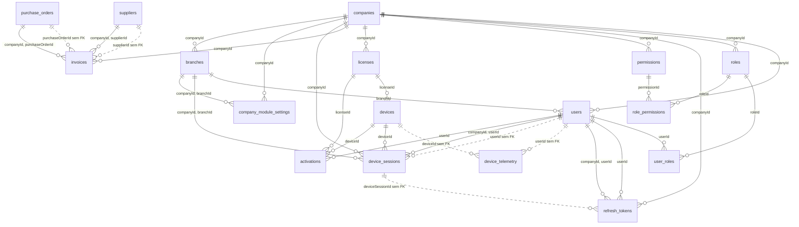

### Auditoria, observabilidade e operação

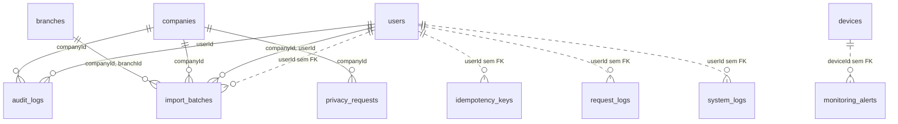

### Políticas e calendário

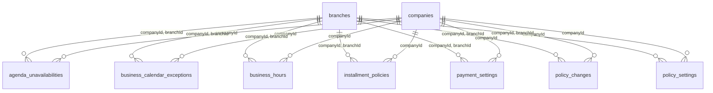

### Catálogo e estoque

```mermaid
erDiagram
  companies ||--o{ categories : "companyId"
  categories ||--o{ categories : "companyId, parentId"
  products ||--o{ combo_items : "comboId"
  products ||--o{ combo_items : "productId"
  branches ||--o{ damage_records : "companyId, branchId"
  companies ||--o{ damage_records : "companyId"
  products ||--o{ damage_records : "companyId, productId"
  products ||..o{ damage_records : "productId sem FK"
  branches ||--o{ inventories : "companyId, branchId"
  companies ||--o{ inventories : "companyId"
  inventories ||--o{ inventory_counts : "inventoryId"
  products ||--o{ inventory_counts : "productId"
  companies ||--o{ product_barcodes : "companyId"
  products ||--o{ product_barcodes : "companyId, productId"
  products ||..o{ product_barcodes : "productId sem FK"
  companies ||--o{ product_images : "companyId"
  products ||--o{ product_images : "companyId, productId"
  products ||..o{ product_images : "productId sem FK"
  branches ||--o{ products : "companyId, branchId"
  categories ||--o{ products : "companyId, categoryId"
  companies ||--o{ products : "companyId"
  categories ||..o{ products : "categoryId sem FK"
  products ||--o{ purchase_order_items : "productId"
  purchase_orders ||--o{ purchase_order_items : "purchaseOrderId"
  branches ||--o{ purchase_orders : "companyId, branchId"
  companies ||--o{ purchase_orders : "companyId"
  suppliers ||--o{ purchase_orders : "companyId, supplierId"
  suppliers ||..o{ purchase_orders : "supplierId sem FK"
  branches ||--o{ stock_movements : "companyId, branchId"
  companies ||--o{ stock_movements : "companyId"
  products ||--o{ stock_movements : "companyId, productId"
  users ||--o{ stock_movements : "companyId, userId"
  products ||..o{ stock_movements : "productId sem FK"
  users ||..o{ stock_movements : "userId sem FK"
  branches ||--o{ stock_reservations : "companyId, branchId"
  sales_channels ||--o{ stock_reservations : "companyId, channelId"
  companies ||--o{ stock_reservations : "companyId"
  external_orders ||--o{ stock_reservations : "companyId, orderId"
  products ||--o{ stock_reservations : "companyId, productId"
  products ||..o{ stock_reservations : "productId sem FK"
  branches ||--o{ supplier_return_events : "companyId, branchId"
  companies ||--o{ supplier_return_events : "companyId"
  supplier_returns ||--o{ supplier_return_events : "companyId, returnId"
  users ||--o{ supplier_return_events : "companyId, userId"
  users ||..o{ supplier_return_events : "userId sem FK"
  branches ||--o{ supplier_return_items : "companyId, branchId"
  damage_records ||--o{ supplier_return_items : "companyId, damageRecordId"
  companies ||--o{ supplier_return_items : "companyId"
  products ||--o{ supplier_return_items : "companyId, productId"
  supplier_returns ||--o{ supplier_return_items : "companyId, returnId"
  products ||..o{ supplier_return_items : "productId sem FK"
  damage_records ||..o{ supplier_return_items : "damageRecordId sem FK"
  branches ||--o{ supplier_returns : "companyId, branchId"
  companies ||--o{ supplier_returns : "companyId"
  purchase_orders ||--o{ supplier_returns : "companyId, purchaseOrderId"
  suppliers ||--o{ supplier_returns : "companyId, supplierId"
  suppliers ||..o{ supplier_returns : "supplierId sem FK"
  purchase_orders ||..o{ supplier_returns : "purchaseOrderId sem FK"
  companies ||--o{ suppliers : "companyId"
  products ||--o{ transfer_items : "productId"
  transfers ||--o{ transfer_items : "transferId"
  companies ||--o{ transfers : "companyId"
  branches ||--o{ transfers : "companyId, fromBranchId"
  branches ||--o{ transfers : "companyId, toBranchId"
  branches ||..o{ transfers : "fromBranchId sem FK"
  branches ||..o{ transfers : "toBranchId sem FK"
```

### Clientes, veículos e pós-venda

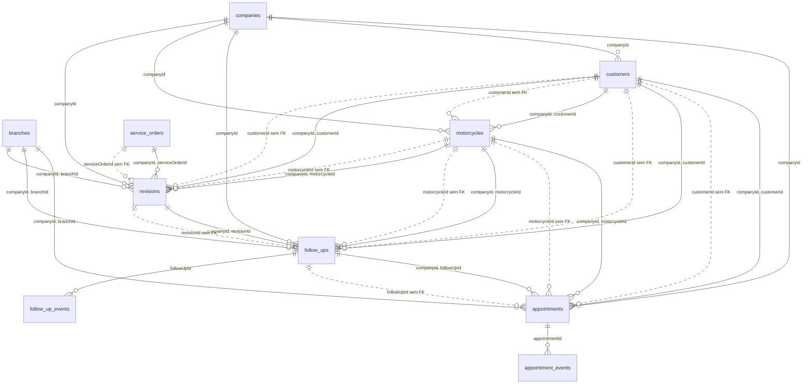

### Vendas, caixa e pagamento

```mermaid
erDiagram
  cash_registers ||--o{ cash_movements : "cashRegisterId"
  users ||..o{ cash_movements : "userId sem FK"
  branches ||--o{ cash_registers : "companyId, branchId"
  companies ||--o{ cash_registers : "companyId"
  users ||--o{ cash_registers : "companyId, userId"
  users ||..o{ cash_registers : "userId sem FK"
  branches ||--o{ discount_events : "companyId, branchId"
  companies ||--o{ discount_events : "companyId"
  quotes ||--o{ discount_events : "companyId, quoteId"
  sales ||--o{ discount_events : "companyId, saleId"
  service_orders ||--o{ discount_events : "companyId, serviceOrderId"
  sales ||..o{ discount_events : "saleId sem FK"
  service_orders ||..o{ discount_events : "serviceOrderId sem FK"
  quotes ||..o{ discount_events : "quoteId sem FK"
  companies ||--o{ discount_rules : "companyId"
  roles ||..o{ discount_rules : "roleId sem FK"
  branches ||--o{ partners : "companyId, branchId"
  companies ||--o{ partners : "companyId"
  branches ||--o{ payment_exceptions : "companyId, branchId"
  companies ||--o{ payment_exceptions : "companyId"
  payments ||--o{ payment_exceptions : "companyId, paymentId"
  sales ||--o{ payment_exceptions : "companyId, saleId"
  payments ||..o{ payment_exceptions : "paymentId sem FK"
  sales ||..o{ payment_exceptions : "saleId sem FK"
  agreement_companies ||--o{ payments : "companyId, agreementCompanyId"
  employee_agreements ||--o{ payments : "companyId, employeeAgreementId"
  companies ||--o{ payments : "companyId"
  sales ||--o{ payments : "companyId, saleId"
  sales ||..o{ payments : "saleId sem FK"
  agreement_companies ||..o{ payments : "agreementCompanyId sem FK"
  employee_agreements ||..o{ payments : "employeeAgreementId sem FK"
  products ||--o{ sale_items : "productId"
  sales ||--o{ sale_items : "saleId"
  branches ||--o{ sales : "companyId, branchId"
  cash_registers ||--o{ sales : "companyId, cashRegisterId"
  sales_channels ||--o{ sales : "companyId, channelId"
  customers ||--o{ sales : "companyId, customerId"
  companies ||--o{ sales : "companyId"
  users ||--o{ sales : "companyId, userId"
  partners ||--o{ sales : "partnerId"
  customers ||..o{ sales : "customerId sem FK"
  users ||..o{ sales : "userId sem FK"
  cash_registers ||..o{ sales : "cashRegisterId sem FK"
  companies ||--o{ tef_payments : "companyId"
  payments ||--o{ tef_payments : "companyId, paymentId"
  sales ||--o{ tef_payments : "companyId, saleId"
  service_orders ||--o{ tef_payments : "companyId, serviceOrderId"
  sales ||..o{ tef_payments : "saleId sem FK"
  service_orders ||..o{ tef_payments : "serviceOrderId sem FK"
  payments ||..o{ tef_payments : "paymentId sem FK"
```

### Financeiro e convênios

```mermaid
erDiagram
  branches ||--o{ accounts_payable : "companyId, branchId"
  companies ||--o{ accounts_payable : "companyId"
  suppliers ||--o{ accounts_payable : "companyId, supplierId"
  suppliers ||..o{ accounts_payable : "supplierId sem FK"
  agreement_companies ||--o{ accounts_receivable : "companyId, agreementCompanyId"
  branches ||--o{ accounts_receivable : "companyId, branchId"
  customers ||--o{ accounts_receivable : "companyId, customerId"
  employee_agreements ||--o{ accounts_receivable : "companyId, employeeAgreementId"
  companies ||--o{ accounts_receivable : "companyId"
  customers ||..o{ accounts_receivable : "customerId sem FK"
  agreement_companies ||..o{ accounts_receivable : "agreementCompanyId sem FK"
  employee_agreements ||..o{ accounts_receivable : "employeeAgreementId sem FK"
  branches ||--o{ agreement_companies : "companyId, branchId"
  companies ||--o{ agreement_companies : "companyId"
  agreement_companies ||--o{ collection_attempts : "companyId, agreementCompanyId"
  branches ||--o{ collection_attempts : "companyId, branchId"
  companies ||--o{ collection_attempts : "companyId"
  accounts_receivable ||--o{ collection_attempts : "companyId, receivableId"
  agreement_companies ||..o{ collection_attempts : "agreementCompanyId sem FK"
  companies ||--o{ commission_rules : "companyId"
  employee_agreements ||--o{ employee_agreement_charges : "companyId, agreementId"
  branches ||--o{ employee_agreement_charges : "companyId, branchId"
  companies ||--o{ employee_agreement_charges : "companyId"
  payments ||--o{ employee_agreement_charges : "companyId, paymentId"
  sales ||--o{ employee_agreement_charges : "companyId, saleId"
  sales ||..o{ employee_agreement_charges : "saleId sem FK"
  payments ||..o{ employee_agreement_charges : "paymentId sem FK"
  branches ||--o{ employee_agreements : "companyId, branchId"
  customers ||--o{ employee_agreements : "companyId, customerId"
  companies ||--o{ employee_agreements : "companyId"
  users ||--o{ employee_agreements : "companyId, userId"
  users ||..o{ employee_agreements : "userId sem FK"
  customers ||..o{ employee_agreements : "customerId sem FK"
  branches ||--o{ employee_payroll_deductions : "companyId, branchId"
  employee_agreement_charges ||--o{ employee_payroll_deductions : "companyId, chargeId"
  companies ||--o{ employee_payroll_deductions : "companyId"
  companies ||--o{ mechanic_commissions : "companyId"
  service_orders ||--o{ mechanic_commissions : "companyId, serviceOrderId"
  service_orders ||..o{ mechanic_commissions : "serviceOrderId sem FK"
```

### Oficina

```mermaid
erDiagram
  branches ||--o{ quote_events : "companyId, branchId"
  companies ||--o{ quote_events : "companyId"
  quotes ||--o{ quote_events : "companyId, quoteId"
  quotes ||..o{ quote_events : "quoteId sem FK"
  quote_versions ||--o{ quote_items : "quoteVersionId"
  products ||..o{ quote_items : "productId sem FK"
  quotes ||--o{ quote_versions : "quoteId"
  branches ||--o{ quotes : "companyId, branchId"
  customers ||--o{ quotes : "companyId, customerId"
  companies ||--o{ quotes : "companyId"
  motorcycles ||--o{ quotes : "companyId, motorcycleId"
  customers ||..o{ quotes : "customerId sem FK"
  motorcycles ||..o{ quotes : "motorcycleId sem FK"
  products ||--o{ service_order_items : "productId"
  service_orders ||--o{ service_order_items : "serviceOrderId"
  service_orders ||--o{ service_order_status_history : "serviceOrderId"
  branches ||--o{ service_order_warranties : "companyId, branchId"
  customers ||--o{ service_order_warranties : "companyId, customerId"
  companies ||--o{ service_order_warranties : "companyId"
  motorcycles ||--o{ service_order_warranties : "companyId, motorcycleId"
  service_orders ||--o{ service_order_warranties : "companyId, serviceOrderId"
  service_orders ||..o{ service_order_warranties : "serviceOrderId sem FK"
  customers ||..o{ service_order_warranties : "customerId sem FK"
  motorcycles ||..o{ service_order_warranties : "motorcycleId sem FK"
  branches ||--o{ service_orders : "companyId, branchId"
  customers ||--o{ service_orders : "companyId, customerId"
  companies ||--o{ service_orders : "companyId"
  motorcycles ||--o{ service_orders : "companyId, motorcycleId"
  users ||--o{ service_orders : "mechanicId"
  quote_versions ||--o| service_orders : "quoteVersionId"
  customers ||..o{ service_orders : "customerId sem FK"
  motorcycles ||..o{ service_orders : "motorcycleId sem FK"
  vehicle_entry_checklists ||--o{ vehicle_entry_checklist_items : "checklistId"
  companies ||--o{ vehicle_entry_checklists : "companyId"
  motorcycles ||--o{ vehicle_entry_checklists : "companyId, motorcycleId"
  service_orders ||--o{ vehicle_entry_checklists : "companyId, serviceOrderId"
  service_orders ||..o{ vehicle_entry_checklists : "serviceOrderId sem FK"
  motorcycles ||..o{ vehicle_entry_checklists : "motorcycleId sem FK"
  branches ||--o{ warranty_claims : "companyId, branchId"
  companies ||--o{ warranty_claims : "companyId"
  service_orders ||--o{ warranty_claims : "companyId, newServiceOrderId"
  service_orders ||--o{ warranty_claims : "companyId, serviceOrderId"
  service_order_warranties ||--o{ warranty_claims : "companyId, warrantyId"
  service_orders ||..o{ warranty_claims : "serviceOrderId sem FK"
  service_orders ||..o{ warranty_claims : "newServiceOrderId sem FK"
```

### Fiscal

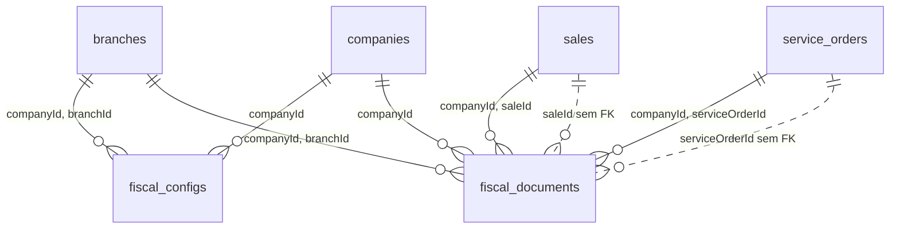

### Canais e integração

```mermaid
erDiagram
  branches ||--o{ channel_api_credentials : "companyId, branchId"
  sales_channels ||--o{ channel_api_credentials : "companyId, channelId"
  companies ||--o{ channel_api_credentials : "companyId"
  branches ||--o{ channel_events : "companyId, branchId"
  sales_channels ||--o{ channel_events : "companyId, channelId"
  companies ||--o{ channel_events : "companyId"
  branches ||--o{ channel_inbound_events : "companyId, branchId"
  sales_channels ||--o{ channel_inbound_events : "companyId, channelId"
  companies ||--o{ channel_inbound_events : "companyId"
  branches ||--o{ channel_outbox : "companyId, branchId"
  sales_channels ||--o{ channel_outbox : "companyId, channelId"
  companies ||--o{ channel_outbox : "companyId"
  branches ||--o{ channel_product_links : "companyId, branchId"
  sales_channels ||--o{ channel_product_links : "companyId, channelId"
  companies ||--o{ channel_product_links : "companyId"
  products ||--o{ channel_product_links : "companyId, productId"
  products ||..o{ channel_product_links : "productId sem FK"
  branches ||--o{ external_order_items : "companyId, branchId"
  companies ||--o{ external_order_items : "companyId"
  external_orders ||--o{ external_order_items : "companyId, orderId"
  products ||--o{ external_order_items : "companyId, productId"
  products ||..o{ external_order_items : "productId sem FK"
  branches ||--o{ external_orders : "companyId, branchId"
  sales_channels ||--o{ external_orders : "companyId, channelId"
  companies ||--o{ external_orders : "companyId"
  sales ||--o{ external_orders : "companyId, saleId"
  sales ||..o{ external_orders : "saleId sem FK"
  branches ||--o{ external_payments : "companyId, branchId"
  sales_channels ||--o{ external_payments : "companyId, channelId"
  companies ||--o{ external_payments : "companyId"
  external_orders ||--o{ external_payments : "companyId, orderId"
  branches ||--o{ fulfillments : "companyId, branchId"
  companies ||--o{ fulfillments : "companyId"
  external_orders ||--o{ fulfillments : "companyId, orderId"
  sales ||--o{ fulfillments : "companyId, saleId"
  sales ||..o{ fulfillments : "saleId sem FK"
  branches ||--o{ sales_channels : "companyId, branchId"
  companies ||--o{ sales_channels : "companyId"
```

### Ajuda e Suporte

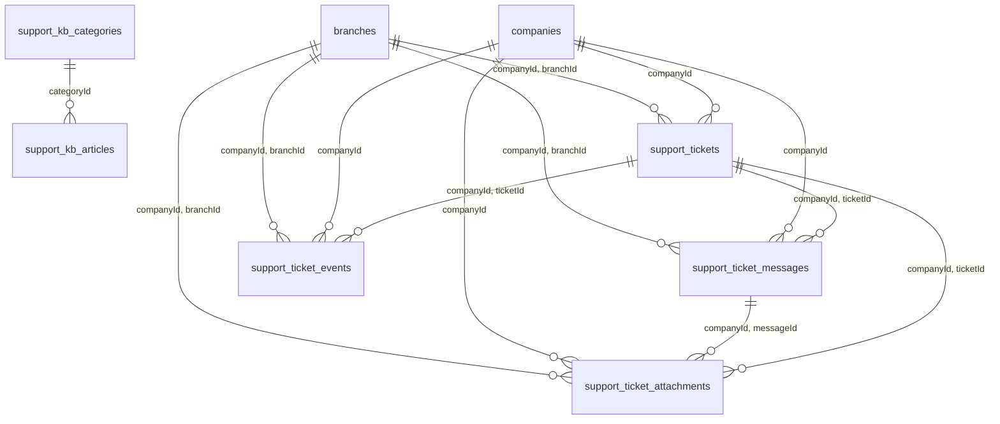

### Não classificada

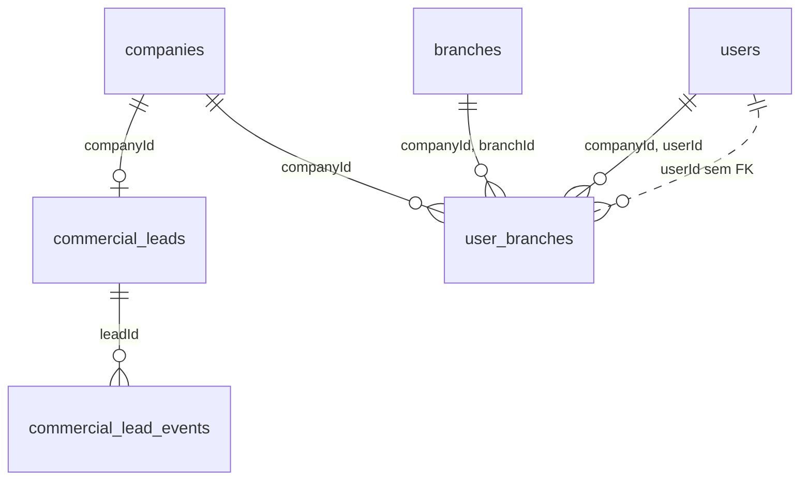

