# Máquinas de estado de negócio (derivadas do código)

Fonte única: enums em `packages/database/prisma/schema.prisma` + lógica em `apps/api/src/services/*.service.ts` e gates em `apps/api/src/routes/*.routes.ts`. Nada aqui é regra desejada: é o que o código **faz** hoje (2026-09-24). Caminhos abreviados: `svc/` = `apps/api/src/services/`, `rt/` = `apps/api/src/routes/`.

**Convenções**
- `idem()` = middleware `idempotency()`: **opcional** — só age se o cliente mandar o header `Idempotency-Key` (`middleware/idempotency.ts:28-30`). Sem header, não protege nada.
- "Guarda atômica" = `updateMany({ where: { status … } })` + checar `count` dentro da transação. "Check fora da tx" = `findFirst` + `if (status…)` antes de `runInTransaction`, seguido de `update` sem condição de status (TOCTOU).
- `auditLog(ação, entidade)` grava só em resposta 2xx e `oldValue` é sempre `null` (`middleware/audit.ts:55,75`).
- Perfis: `SA`=SUPER_ADMIN, `CA`=COMPANY_ADMIN, `MG`=MANAGER, `OP`=OPERATOR, `MC`=MECHANIC, `VW`=VIEWER. `perm:x` = `requirePermission('x')` (RBAC em banco; SA sempre passa, `middleware/permission.ts:22`).
- Marcadores: **[LACUNA]** = defeito/omissão objetiva; **[DECISÃO NECESSÁRIA]** = o código não tem regra e a escolha é de produto.

---

## 1. Venda (`SaleStatus`: PENDING, PAID, PARTIALLY_PAID, CANCELLED, RETURNED)

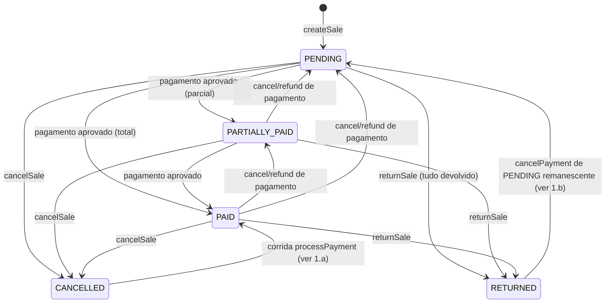

Rotas: `rt/sales.routes.ts` — `router.use(denyUserTypes('MECHANIC'))` (:19) e `requireUserType(SA,CA,MG,OP)` (:86) para todos os writes.

| Estado atual | Ação | Próximo | Perfil | Pré-condições checadas | Efeitos colaterais | Auditoria | Idempotência |
|---|---|---|---|---|---|---|---|
| — | `createSale` `svc/sale.service.ts:24` · `POST /sales` `rt/sales.routes.ts:89` | PENDING | SA,CA,MG,OP | caixa OPEN da mesma filial (:55-75, fora da tx); produto ativo; saldo (re-checado com `FOR UPDATE` :328-341); desconto/convênio com dupla autorização MG+ (:206-231) | `StockMovement SALE` negativo por item; nenhum efeito financeiro | CREATE/Sale | `idem()`; advisory lock 4202 só para numeração (:267) |
| PENDING/PARTIALLY_PAID/PAID | `cancelSale` `:536` · `POST /:id/cancel` `:120` | CANCELLED | SA,CA,MG,OP + autorizador MG/CA/SA (`verifyDualAuthorization`) | status ≠ CANCELLED/RETURNED; motivo ≥ 3 | `StockMovement RETURN` = `item.quantity` **integral** (:621-635); pagamentos não aprovados→CANCELLED, aprovados→REFUNDED; `CashMovement CANCELLATION` + `expectedAmount -= approvedTotal` só se caixa OPEN (:663-684) | UPDATE/Sale + `Logger.security SALE_CANCELLATION_COMPLETED` | guarda atômica `updateMany status notIn [CANCELLED,RETURNED]` (:601-613) + `idem()` + `rateLimitAuthorizer` |
| qualquer ≠ CANCELLED | `returnSale` `:717` · `POST /:id/return` `:157` | mesmo status (parcial) ou RETURNED (total) | idem cancel (dupla autorização) | status ≠ CANCELLED (**fora da tx**, :739); qtd ≤ restante por item | `returnedQuantity += q` (guarda `lte` :813-819); `StockMovement RETURN`; se total, pagamentos APPROVED→REFUNDED; `CashMovement RETURN` = `min(Σ q·unitPrice, approvedTotal)` se caixa OPEN (:860-883) | UPDATE/Sale + `SALE_RETURN_COMPLETED` | guarda atômica **só por item** (`returnedQuantity lte`); nenhuma no status da venda; `idem()` |
| PENDING/PARTIALLY_PAID | `applyApprovedPaymentEffects` (via pagamento, §2) | PARTIALLY_PAID/PAID | — | — | ver §2 | — | — |

**Transições impossíveis que o código ACEITA**
- **[LACUNA] Cancelar depois de devolução parcial devolve estoque e caixa em dobro.** Devolução parcial não muda o status (`sale.service.ts:885-889` grava `{}`), então `cancelSale` passa (:553-558) e reentra `item.quantity` inteiro, ignorando `returnedQuantity` (:628), e decrementa o caixa pelo `approvedTotal` inteiro (:663-684), mesmo com a devolução já tendo decrementado o proporcional (:864-880).
- **[LACUNA] Corrida cancelar × devolver.** `returnSale` não re-checa o status da venda dentro da tx (só a guarda do item, :813). Um cancel e uma devolução concorrentes fazem os dois estornos de estoque e de caixa.
- **[DECISÃO NECESSÁRIA]** `returnSale` aceita venda PENDING (nada pago): gera entrada de estoque e marca RETURNED sem qualquer efeito financeiro. Pode ser "devolução" ou deveria ser cancelamento?
- **[LACUNA]** O estorno da devolução usa `unitPrice` bruto (:821) e o teto é aplicado por chamada (:863). A soma de devoluções parciais pode exceder o valor efetivamente pago quando há desconto.
- **1.a / 1.b**: ver §2 (pagamento reescreve o status da venda sem olhar CANCELLED/RETURNED).

**Transições esperadas que não existem**
- **[LACUNA]** `cancelSale`/`returnSale` não cancelam o `FiscalDocument` AUTHORIZED da venda (§11).
- **[DECISÃO NECESSÁRIA]** Não há expiração de venda PENDING (estoque já baixado em `createSale` fica preso sem pagamento).

---

## 2. Pagamento (`PaymentStatus`: PENDING, APPROVED, REJECTED, CANCELLED, REFUNDED)

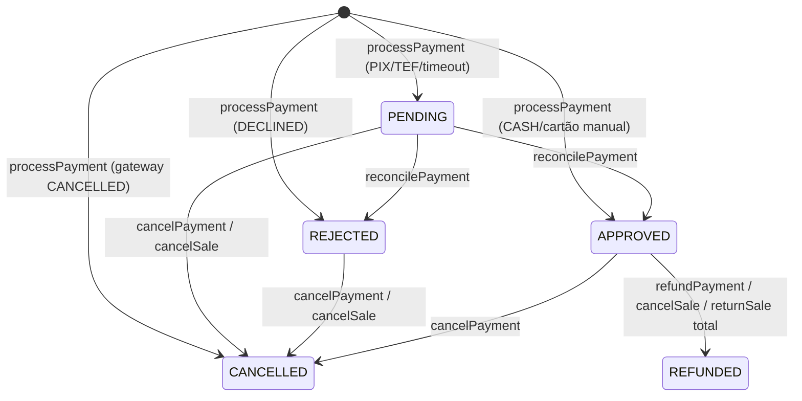

| Estado atual | Ação | Próximo | Perfil | Pré-condições | Efeitos colaterais | Auditoria | Idempotência |
|---|---|---|---|---|---|---|---|
| — | `processPayment` `svc/payment.service.ts:39` · `POST /payments` `rt/payments.routes.ts:72` | conforme adaptador (`toDbStatus` :21) | SA,CA,MG,OP | venda ≠ CANCELLED/RETURNED (**fora da tx**, :95); saldo restante (APPROVED+PENDING); re-checagem só do saldo APPROVED sob `FOR UPDATE` em `sales` (:191-209); parcelas via `InstallmentPolicy` | se APPROVED: venda `status/paidAmount/changeAmount` (:281-288); `CashMovement SALE` + `expectedAmount +=` só se caixa OPEN (:299-329) | CREATE/Payment | `transactionId @unique` + retorno do existente em P2002 (:248-255); `idem()`; `FOR UPDATE` na venda |
| PENDING | `reconcilePayment` `:342` · `POST /:id/reconcile` `:98` | APPROVED/REJECTED/CANCELLED ou inalterado | SA,CA,MG | não terminal; tem `transactionId` | se APPROVED: mesmos efeitos acima, com `approvedAmount` lido **antes da tx** (:396-398) | UPDATE/Payment | **nenhuma** (update sem condição de status, :384) |
| PENDING/APPROVED/REJECTED | `cancelPayment` `:519` · `POST /:id/cancel` `:116` | CANCELLED | `perm:finance:reverse` | ≠ CANCELLED/REFUNDED | recalcula status/paidAmount da venda (:552-574); se era APPROVED: `CashMovement CANCELLATION` se caixa OPEN (:576-578) | **nenhuma** (sem `auditLog`) | guarda atômica (:542-548); sem `idem()` |
| APPROVED | `refundPayment` `:585` · `POST /:id/refund` `:130` | REFUNDED | `perm:finance:reverse` | = APPROVED | recalcula venda (:614-627); `CashMovement CANCELLATION` se caixa OPEN (:629) | **nenhuma** | guarda atômica (:602-608) + `idem()` |

**Transições impossíveis que o código ACEITA**
- **[LACUNA] Venda CANCELLED volta a PAID.** `processPayment` checa o status da venda fora da tx (:95). O `FOR UPDATE` (:191) espera o `cancelSale` concorrente commitar, mas depois só re-checa o saldo, não o status. `applyApprovedPaymentEffects` grava `status: PAID` por cima de CANCELLED (:281-288) e lança entrada no caixa.
- **[CORRIGIDO 2026-09-25] Pagamento reescreve venda terminal.** `cancelPayment`/`refundPayment` recalculavam o status da venda sem olhar se ela estava CANCELLED/RETURNED: cancelar o PENDING que sobra após `returnSale` levava a venda RETURNED→PENDING (reaberta para pagamento). Agora `saleStatusAfterReversal` lê o status na transação e mantém CANCELLED/RETURNED (prova: `payment-terminal-reconciliation.integration.test.ts`, "venda devolvida"). A reconciliação aprovando esse PENDING já não leva RETURNED→PAID (`lockSaleForPayment` recusa), mas o pagamento fica **preso em PENDING** (o job tenta a cada 5 min e engole o erro) mesmo com o dinheiro capturado no provedor.
- **[DECISÃO NECESSÁRIA] Aprovação tardia em venda devolvida/cancelada.** O provedor aprovou depois da devolução: registrar o pagamento como APPROVED com alerta para estorno (e lançar ou não no caixa), estornar automaticamente no provedor, ou manter pendente para tratamento manual? Hoje: pendente, sem alerta.
- **[LACUNA] Estorno em dobro no caixa:** `refundPayment` em venda com devolução parcial já estornada no caixa (`sale.service.ts:864-880`) decrementa o valor inteiro do pagamento de novo (:629).
- **[LACUNA] `reconcilePayment` sem guarda:** duas reconciliações concorrentes aplicam os efeitos (`CashMovement SALE`, `expectedAmount +=`) duas vezes. Hoje fica latente, porque os adaptadores sempre devolvem PENDING (`:370-374`).
- **[DECISÃO NECESSÁRIA]** `cancelPayment` de pagamento APPROVED é um estorno sem dupla autorização (só `finance:reverse`), diferente de `cancelSale`/`returnSale`.

---

**Pagamento em dinheiro — recebido e troco [CORRIGIDO 2026-09-25].** `Payment.amount` é sempre o valor APLICADO à venda
(no máximo o que falta pagar). Em dinheiro, `receivedAmount` guarda o que o cliente entregou (`amount` enviado acima do
restante, ou `receivedAmount` explícito ≥ `amount`) e `changeAmount` o troco. Caixa (`CashMovement SALE` e
`expectedAmount`), `paidAmount` da venda e estorno usam só o aplicado; `Sale.changeAmount` acumula o troco.
`receivedAmount` em outra forma de pagamento é recusado. Antes, o valor entregue inteiro entrava no caixa (sobra
fantasma no fechamento) e seria devolvido num estorno. Prova: `cash-payment-change.integration.test.ts`.

**Controle de cédulas (opcional) [NOVO 2026-09-25].** `payment_settings.cashDenominationControl` por empresa (linha com
`branchId` nulo) com override por filial; sem linha = desligado. Só SUPER_ADMIN/COMPANY_ADMIN alteram (`PUT
/api/payment-settings`, auditado); o efetivo é lido por qualquer usuário da empresa (o PDV decide se pede as cédulas).
Ligado: pagamento em dinheiro exige `cashBreakdown` [{ value, quantity }] só com valores do Real, quantidades inteiras
positivas e soma igual ao recebido; gravado normalizado em `Payment.cashBreakdown`. Desligado: registra só recebido,
troco e caixa (composição opcional, validada se enviada). O relatório de fechamento traz `cashReceived` (recebido,
troco, composição somada). Pagamentos já gravados não são alterados. Prova: `payment-settings-cash-breakdown.integration.test.ts`.

**Pagamento por terminal/provedor (TEF, PSP de PIX) [NOVO 2026-09-25].** `payment_settings` guarda `cardProvider`,
`pixProvider` e `terminalId` (herança campo a campo filial → empresa; padrão `MANUAL`). Só nomes registrados no servidor
(`payment-adapters/index.ts::registerPaymentProvider`) são aceitos; hoje só `MANUAL` existe em produção — cartão
confirmado pelo operador na maquininha e PIX PENDING até conciliação (nenhuma integração fingida). Com um provedor
externo (`external: true`), o pagamento segue **intenção primeiro**: (1) grava PENDING com `transactionId` (chave de
idempotência; gerada pelo servidor se ausente) e `provider`, sob lock da venda, reservando o saldo; (2) envia ao terminal o
valor da venda (sem redigitação); (3) liquida: APPROVED → efeitos na venda e no caixa; DECLINED → REJECTED (saldo
liberado); exceção/sem resposta/TIMEOUT/UNKNOWN → segue PENDING, **nunca** recusado. Repetir com a mesma chave devolve o
mesmo pagamento sem cobrar; sem chave, o saldo reservado barra a segunda cobrança. Reconciliação (`POST
/payments/:id/reconcile` e job `reconcile-external-payments` a cada 5 min, pendentes há > 1 min) consulta o provedor
gravado no pagamento e liquida com guarda atômica PENDING → final (reconciliações simultâneas aplicam uma vez).
**Cancelar pendente externo** (`POST /payments/:id/cancel`): o provedor decide primeiro (`adapter.cancel`) —
CANCELLED/DECLINED → CANCELLED aqui; já APPROVED → liquida como aprovado e responde 409 pedindo estorno; sem resposta,
sem suporte a cancelamento ou resposta incerta → 409 e segue PENDING (antes cancelava só aqui e o provedor podia
capturar depois). O cancelamento local tem guarda no status lido: se uma liquidação acontece no meio, 409 e nada é
revertido pela metade (antes cancelava um pagamento já aprovado sem reverter o caixa).
[LIMITAÇÃO] sem terminal/TEF/PSP real neste ambiente; o fluxo é provado com um terminal falso registrado só no teste.
Prova: `payment-terminal-reconciliation.integration.test.ts`.

## 3. Caixa (`CashRegisterStatus`: OPEN, CLOSED)

**Caixa — quem opera [CORRIGIDO].** O caixa é do operador que o abriu (`CashRegister.userId`, "1 caixa aberto por usuário"). Fechar, lançar reforço, pedir retirada e vender nele: OPERATOR só no próprio; MANAGER nos da sua filial (supervisão, ex.: fechar caixa esquecido); COMPANY_ADMIN/SUPER_ADMIN nos da empresa (`cash-register.service.ts::assertCanOperateRegister`, usado também em `createSale`). Antes, outro OPERATOR da mesma filial fechava o caixa do colega (jornada real do PDV, HTTP 200). Prova: `test/integration/cash-register-owner.integration.test.ts`.

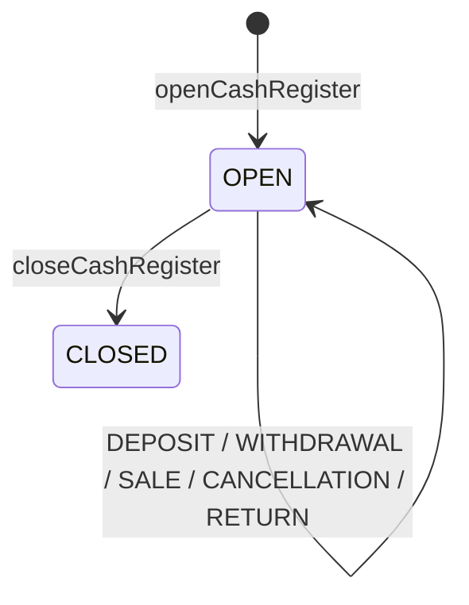

Rotas: `rt/cash-register.routes.ts` com `denyUserTypes('MECHANIC')` (:26) e `requireUserType(SA,CA,MG,OP)` (:123).

| Estado | Ação | Próximo | Perfil | Pré-condições | Efeitos | Auditoria | Idempotência |
|---|---|---|---|---|---|---|---|
| — | `openCashRegister` `svc/cash-register.service.ts:14` · `POST /open` `:126` | OPEN | SA,CA,MG,OP | nenhum caixa OPEN do usuário na filial nem com o mesmo número | `CashMovement OPENING` | CREATE/CashRegister | índices únicos parciais `WHERE status='OPEN'` (P2002 :88) + `idem()` |
| OPEN | `closeCashRegister` `:98` · `POST /:id/close` `:146` | CLOSED | SA,CA (empresa), MG (filial), OP (**só o próprio caixa**) — `assertCanOperateRegister` [CORRIGIDO] | status OPEN | `expectedAmount` recalculado dos movimentos lidos **antes da tx** (:107-136); `CashMovement CLOSING` | UPDATE/CashRegister | guarda atômica (:152-167) + `idem()` |
| OPEN | `addCashMovement` (DEPOSIT) `:211` · `POST /movement` `:165` | OPEN | SA,CA,MG,OP; MG/OP só na própria filial | OPEN (fora da tx) | `CashMovement DEPOSIT`; `expectedAmount = valorLido + amount` (**absoluto**, :270-276) | UPDATE/CashRegister | **nenhuma** |
| OPEN | `requestWithdrawal` `:297` · `POST /:id/withdrawal` `:202` | OPEN | idem + autorizador MG/CA/SA | OPEN (fora da tx); valor > 0; motivo | `CashMovement WITHDRAWAL`; `expectedAmount -=` | UPDATE/CashMovement + `WITHDRAWAL_COMPLETED` | `idem()` + `rateLimitAuthorizer` |

**Transições impossíveis que o código ACEITA**
- **[LACUNA] Lost update no saldo esperado:** `addCashMovement` grava `expectedAmount` absoluto a partir de uma leitura feita fora da tx (:270). Um pagamento aprovado concorrente (`increment`, `payment.service.ts:326-329`) é sobrescrito. `POST /movement` também não tem `idem()`, então um duplo clique gera dois reforços.
- **[LACUNA] Movimento em caixa CLOSED:** `requestWithdrawal`/`addCashMovement` (:231-240, :319-324) checam OPEN fora da tx. `applyApprovedPaymentEffects`, `cancelSale` e `returnSale` leem o status sem lock. Todos podem inserir movimento depois de um fechamento concorrente. Além disso, o fechamento calcula `expectedAmount` com movimentos lidos antes da própria tx (:107), então um movimento commitado nessa janela fica fora do valor de fechamento.
- **[DECISÃO NECESSÁRIA]** Não existe reabertura (CLOSED→OPEN) nem ajuste pós-fechamento: estornos de turno fechado são silenciosamente pulados (`cashAdjusted: false`, `sale.service.ts:662-685`).

---

## 4. Orçamento (`QuoteStatus`: DRAFT, SENT, APPROVED, REJECTED, EXPIRED, CONVERTED)

Os gaps D1–D8 de `docs/CORTEX/historico/registro-de-auditoria-2026-09-14-a-25.md` (seção D) valem aqui e não são repetidos (EXPIRED nunca definido = D2; `addVersion` em APPROVED = D8).

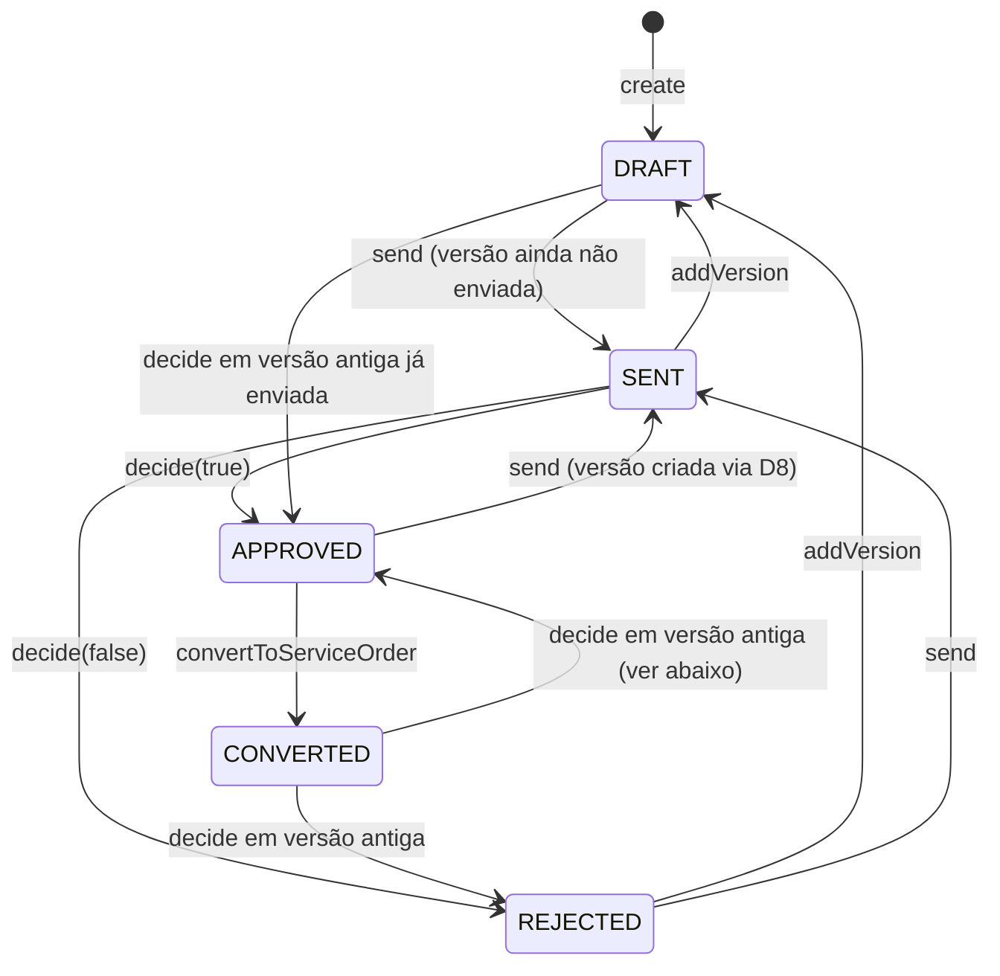

Rotas: `rt/quotes.routes.ts` com `requireUserType(SA,CA,MG,OP,MC)` (:66). **Nenhuma rota tem `idem()`.**

| Estado | Ação | Próximo | Perfil | Pré-condições | Efeitos | Auditoria | Idempotência |
|---|---|---|---|---|---|---|---|
| — | `create` `svc/quote.service.ts:96` · `POST /` `:68` | DRAFT | SA,CA,MG,OP,MC | ≥ 1 item; cliente/moto/filial da empresa | v1 criada | CREATE/Quote | advisory lock 4204 (numeração) |
| ≠ CONVERTED | `addVersion` `:215` · `POST /:id/versions` `:87` | DRAFT se era SENT/REJECTED; senão inalterado | idem | ≠ CONVERTED (fora da tx) | nova versão | UPDATE/Quote | `@@unique([quoteId, versionNumber])` + retry |
| ≠ CONVERTED | `send` `:294` · `POST /:id/send` `:102` | SENT | idem | ≠ CONVERTED; versão existe; se já tem `sentAt`, no-op | `sentAt` | UPDATE/Quote | no-op em `sentAt` (fora da tx) |
| **qualquer** | `decide` `:329` · `POST /:id/decide` `:112` | APPROVED/REJECTED | idem | versão enviada e sem `approvedAt` (**fora da tx**) | `isApproved/approvedAt/decidedBy` | UPDATE/Quote | **nenhuma** |
| APPROVED | `convertToServiceOrder` `:387` · `POST /:id/convert` `:127` | CONVERTED | idem | = APPROVED (fora da tx); versão aprovada sem OS | cria OS ENTRADA + itens + histórico | UPDATE/Quote | `ServiceOrder.quoteVersionId @unique` + advisory lock 4201 |

**Transições impossíveis que o código ACEITA**
- **[LACUNA] `decide` não olha o status do orçamento** (:343-373). Uma versão antiga enviada e nunca decidida pode ser decidida depois: (a) com o orçamento CONVERTED, o status volta para APPROVED/REJECTED (:370-373); (b) com uma versão mais nova em DRAFT, o orçamento fica APPROVED e `convert` pega a versão aprovada de maior número (:423-427), que pode não ser a mais recente.
- **[LACUNA] Decisão concorrente:** `approvedAt` é checado fora da tx (:355). Aprovar e recusar ao mesmo tempo gravam as duas decisões, e o status final da `Quote` pode divergir de `QuoteVersion.isApproved`.
- **[DECISÃO NECESSÁRIA]** MECHANIC pode registrar decisão do cliente e converter em OS (gate :66).

---

## 5. Ordem de Serviço (`ServiceOrderStatus`)

Tabela `ALLOWED_TRANSITIONS` em `svc/service-order.service.ts:11-21` (única máquina explícita do sistema).

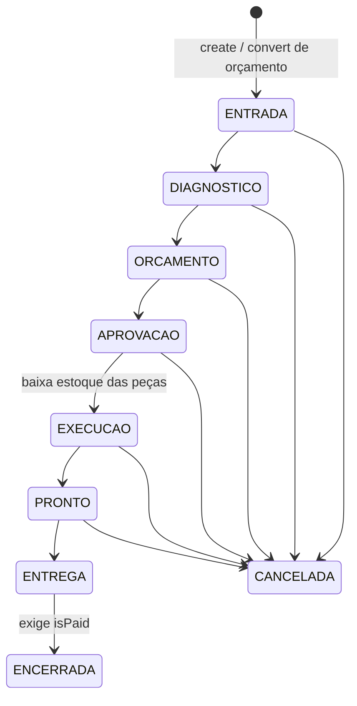

Rotas: `rt/service-orders.routes.ts`, `requireWorkshopWriter` = SA,CA,MG,OP,MC (:30).

| Estado | Ação | Próximo | Perfil | Pré-condições | Efeitos | Auditoria | Idempotência |
|---|---|---|---|---|---|---|---|
| — | `create` `:28` · `POST /` `:60` | ENTRADA | writer | cliente/moto da empresa | histórico | CREATE/ServiceOrder | advisory lock 4201 |
| ≠ ENCERRADA/CANCELADA, `!isPaid` | `addItem` `:232` · `POST /:id/items` `:76` | inalterado | writer | status/isPaid fora da tx | totais `increment`; em EXECUCAO/PRONTO/ENTREGA: `StockMovement SALE` com `FOR UPDATE` (:298-340) | UPDATE (describe ADD_ITEM) | nenhuma |
| conforme tabela | `transitionStatus` `:365` · `POST /:id/status` `:105` | `toStatus` | writer (inclui MC, inclusive para CANCELADA) | transição na tabela (**fora da tx**, :377); ENCERRADA exige `isPaid` | EXECUCAO: `StockMovement SALE` por PART `isCompleted=false` (:435-478); histórico | UPDATE/ServiceOrder + `ServiceOrderStatusHistory` | **nenhuma**: `update` sem `where status` (:409) |
| qualquer | `registerPayment` `:537` · `POST /:id/payment` `:179` | inalterado (`isPaid=true`) | `perm:finance:pay` | só `!isPaid` | `AccountsReceivable` PAID; `MechanicCommission` (base = laborTotal) | **nenhuma** (sem `auditLog`) | guarda atômica `isPaid:false` (:568-575) |

**Transições impossíveis que o código ACEITA**
- **[LACUNA] Transição concorrente baixa estoque em dobro.** O status é validado fora da tx e o `update` não tem condição (:372-409). Dois `APROVACAO→EXECUCAO` simultâneos leem `isCompleted=false` sem lock (:436) e ambos geram `StockMovement SALE`. O saldo é lido fora da tx, sem `FOR UPDATE` e ignorando `allowNegativeStock` (:443), ao contrário de `addItem`.
- **[LACUNA] Pagar OS em qualquer status**, inclusive CANCELADA ou ENTRADA: `registerPayment` só checa `isPaid` (:542). Gera recebível PAID e comissão para uma OS cancelada.
- **[LACUNA] CANCELADA após EXECUCAO/PRONTO não devolve peças** (nenhum `RETURN`) e, se já paga, não estorna recebível nem comissão.
- **[DECISÃO NECESSÁRIA]** Não há retorno de etapa (ex.: EXECUCAO→ORCAMENTO para orçamento complementar), e ENTREGA não pode ser cancelada.

---

## 6. Pedido de compra (`PurchaseOrderStatus`: DRAFT, SENT, CONFIRMED, RECEIVED, CANCELLED)

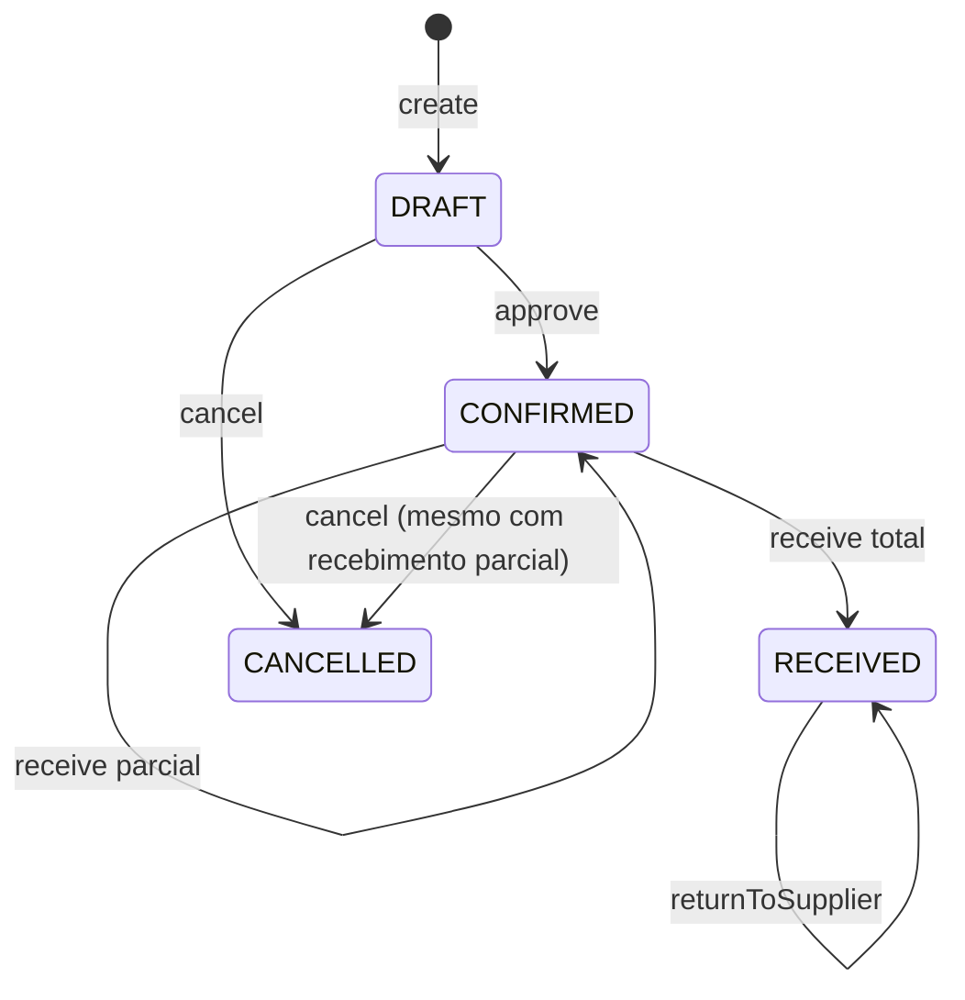

Rotas: `rt/purchase-orders.routes.ts`, `denyUserTypes('MECHANIC')` (:22).

| Estado | Ação | Próximo | Perfil | Pré-condições | Efeitos | Auditoria | Idempotência |
|---|---|---|---|---|---|---|---|
| — | `create` `svc/purchase-order.service.ts:11` · `POST /` `:52` | DRAFT | `perm:purchases:manage` | itens; fornecedor/produtos da empresa | — | CREATE | advisory lock 4203 |
| DRAFT/SENT | `approve` `:160` · `POST /:id/approve` `:68` | CONFIRMED | `perm:purchases:approve` | status fora da tx | `approvedBy/At` | UPDATE | **nenhuma** |
| ≠ RECEIVED/CANCELLED | `cancel` `:175` · `POST /:id/cancel` `:82` | CANCELLED | `perm:purchases:manage` | status fora da tx | — | UPDATE | **nenhuma** |
| CONFIRMED | `receive` `:196` · `POST /:id/receive` `:97` | CONFIRMED/RECEIVED | `perm:purchases:receive` | re-checa CONFIRMED sob `FOR UPDATE` (:272-276); qtd ≤ restante; NF não duplicada | `StockMovement PURCHASE`; `Product.costPrice`; `Invoice` | UPDATE | `FOR UPDATE` + `Invoice.accessKey @unique` + `idem()` |
| RECEIVED | `returnToSupplier` `:405` · `POST /:id/return` `:119` | inalterado | `perm:purchases:receive` | produto do pedido; qtd ≤ recebido − devolvido (tudo sob `FOR UPDATE`) | `StockMovement LOSS` (ref `PurchaseReturn`) | UPDATE | `FOR UPDATE` |

**Transições impossíveis que o código ACEITA**
- **[LACUNA]** `cancel` e `approve` fazem `update` sem condição de status (:169, :187). Um cancel que corre com `receive` espera o lock e depois grava CANCELLED por cima de RECEIVED. Um approve que corre com cancel leva CANCELLED→CONFIRMED.
- **[DECISÃO NECESSÁRIA]** Cancelar um CONFIRMED com recebimento parcial é aceito (:180-187): o estoque recebido fica e o saldo pendente some sem registro.

**Transições esperadas que não existem**
- **[LACUNA]** `SENT` nunca é atribuído (só aparece na lista de `approve`, :165).
- **[DECISÃO NECESSÁRIA]** O recebimento não gera `AccountsPayable` (nenhum `accountsPayable.create` fora de `financial.service.ts`).

---

## 7. Transferência entre filiais (`TransferStatus`: PENDING, IN_TRANSIT, RECEIVED, CANCELLED)

"Aprovada" não é um status: é PENDING com `approvedBy` preenchido.

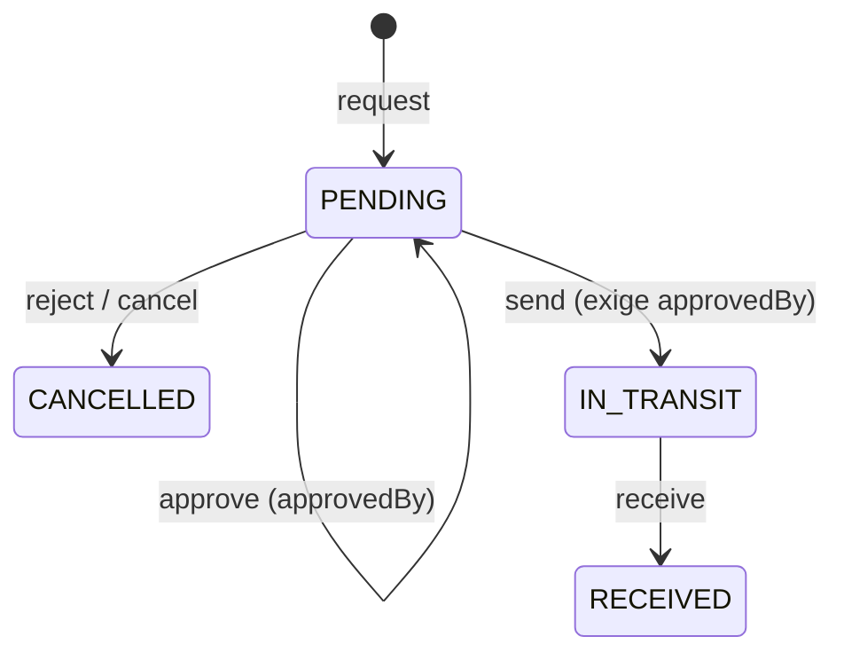

Rotas: `rt/transfers.routes.ts`, `requireStockWriter` = SA,CA,MG,OP,MC (:21). **Nenhuma rota tem `idem()`.**

| Estado | Ação | Próximo | Perfil | Pré-condições | Efeitos | Auditoria | Idempotência |
|---|---|---|---|---|---|---|---|
| — | `request` `svc/transfer.service.ts:23` · `POST /` `:23` | PENDING | stock writer | filiais distintas da empresa | — | CREATE | retry de numeração |
| PENDING | `approve` `:141` · `:65` | PENDING | MG,CA,SA | PENDING (fora da tx) | `approvedBy/At` | UPDATE | nenhuma |
| PENDING | `reject` `:162` · `:83` / `cancel` `:349` · `:143` | CANCELLED | MG,CA,SA | PENDING (fora da tx) | motivo em `notes` | UPDATE | nenhuma |
| PENDING+aprovada | `send` `:183` · `:106` | IN_TRANSIT | stock writer | status fora da tx; saldo da origem sob `FOR UPDATE` do produto | `TRANSFER_OUT` na origem | UPDATE | **nenhuma** no status |
| IN_TRANSIT | `receive` `:279` · `:125` | RECEIVED | stock writer | status fora da tx; recebido ≤ enviado | `TRANSFER_IN` no destino; divergência em `notes` | UPDATE | **nenhuma** (sem lock nenhum) |

**Transições impossíveis que o código ACEITA**
- **[LACUNA] Duplo clique em "Enviar"/"Receber" duplica estoque.** `send`/`receive` validam o status fora da tx e o `update` final não tem condição (:196/:258, :292/:333). O `FOR UPDATE` do `send` é no produto e não re-checa a transferência, então duas chamadas geram dois `TRANSFER_OUT`. O `receive` não tem lock nenhum: dois `TRANSFER_IN` inflam o estoque do destino.
- **[LACUNA]** `cancel`/`reject` que corre com `send` grava CANCELLED depois do `TRANSFER_OUT` (IN_TRANSIT→CANCELLED com mercadoria fora da origem).
- **[DECISÃO NECESSÁRIA]** Existe um caminho paralelo sem workflow: `POST /stock/transfer` (`rt/stock.routes.ts:184`, `perm:stock:transfer`) move saldo entre filiais direto, sem aprovação nem trânsito.
- **[DECISÃO NECESSÁRIA]** Itens omitidos no `receive` ficam sem `receivedQuantity` e a transferência vira RECEIVED assim mesmo. A divergência não gera movimento de perda.

---

## 8. Estoque / Inventário / Avaria

O estoque não tem status: é um ledger (`StockMovement`). `INVENTORY` é **absoluto** (`svc/stock.service.ts:316-317`). Entradas são PURCHASE, RETURN, TRANSFER_IN e PRODUCTION; saídas são SALE, TRANSFER_OUT e LOSS.

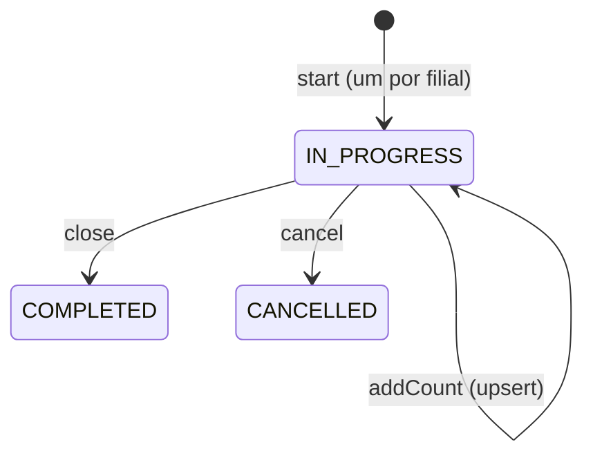

| Estado | Ação | Próximo | Perfil | Pré-condições | Efeitos | Auditoria | Idempotência |
|---|---|---|---|---|---|---|---|
| — | `start` `svc/inventory.service.ts:25` · `POST /inventory` `rt/inventory.routes.ts:26` | IN_PROGRESS | SA,CA,MG,OP,MC | nenhum IN_PROGRESS na filial | — | CREATE | índice único parcial (um IN_PROGRESS por filial) |
| IN_PROGRESS | `addCount` `:116` · `:67` | IN_PROGRESS | idem | status fora da tx | `systemQuantity` só na 1ª contagem | UPDATE/InventoryCount | `@@unique([inventoryId, productId])` (upsert) |
| IN_PROGRESS | `close` `:188` · `:90` | COMPLETED | MG,CA,SA | status fora da tx; ≥ 1 contagem | `StockMovement INVENTORY = countedQuantity` por divergente | UPDATE | **nenhuma** |
| ≠ COMPLETED/CANCELLED | `cancel` `:236` · `:108` | CANCELLED | MG,CA,SA | status fora da tx | — | UPDATE | nenhuma |
| avaria ativa | `damage.reverse` `svc/damage.service.ts:163` · `POST /damage/:id/reverse` `rt/damage.routes.ts:73` | `isReversed=true` | MG,CA,SA | `!isReversed` (**fora da tx**, :170) | `StockMovement RETURN` | UPDATE/DamageRecord | **nenhuma** |

**Transições impossíveis / lacunas**
- **[LACUNA]** `close` × `cancel` concorrentes: nenhum dos dois tem guarda. Um inventário COMPLETED, com estoque já rebaseado, pode terminar CANCELLED.
- **[LACUNA]** `damage.reverse` duplo gera dois `RETURN` para a mesma avaria (:170-197).
- **[DECISÃO NECESSÁRIA]** `INVENTORY` absoluto usa `countedQuantity` no fechamento. Vendas e entradas registradas entre a contagem e o `close` são apagadas do saldo.
- **[LACUNA]** `InventoryStatus.DRAFT` nunca é atribuído (`start` cria direto IN_PROGRESS, :73).
- **[DECISÃO NECESSÁRIA]** Caminhos que ignoram as máquinas: `POST /stock/movement` (qualquer `movementType`/`referenceType`, `rt/stock.routes.ts:129`) e `POST /stock/inventory` (:217, rebase sem a entidade `Inventory`).

---

## 9. Contas a pagar / receber (`AccountStatus`: PENDING, PAID, OVERDUE, CANCELLED)

Mesma forma para os dois (`svc/financial.service.ts`). O estorno **não muda** o original: cria uma linha nova PAID com valor negativo e `referenceType='Reversal'`.

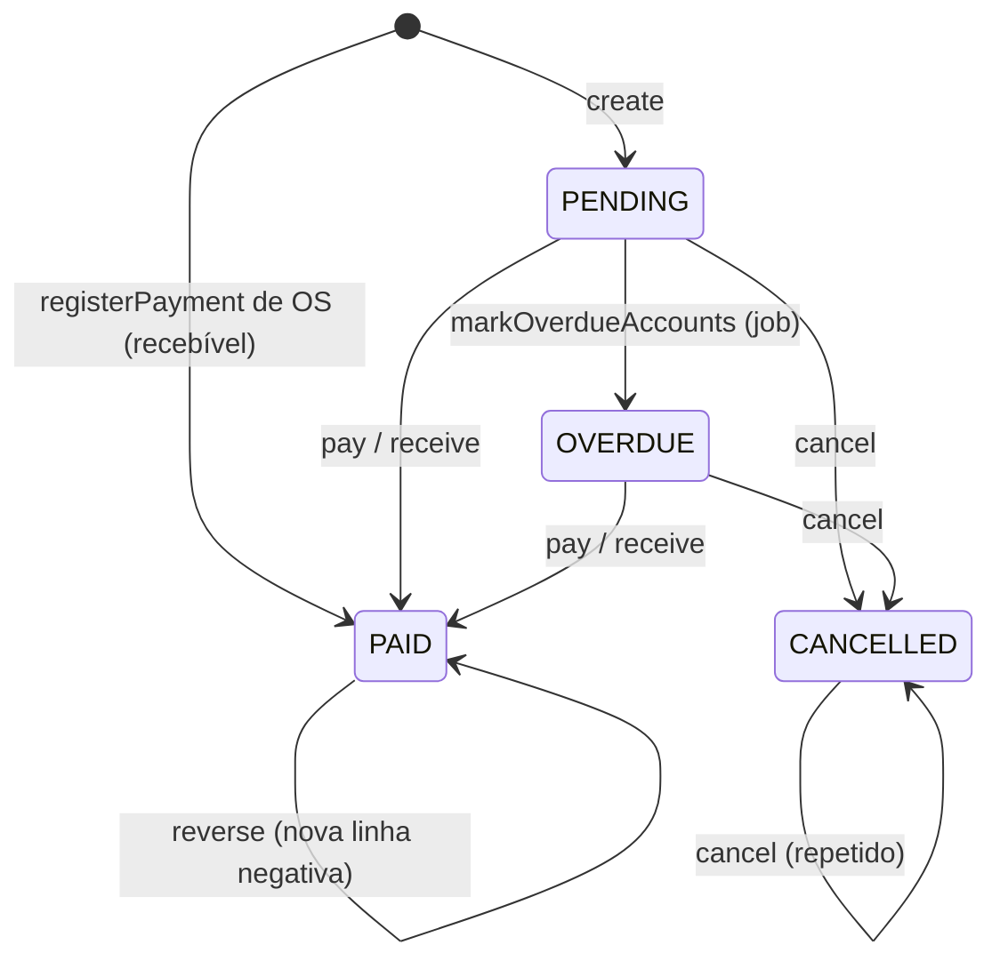

Rotas: `rt/financial.routes.ts`, `denyUserTypes('MECHANIC')` (:21). **Nenhuma rota tem `idem()`.**

| Estado | Ação | Próximo | Perfil | Pré-condições | Efeitos | Auditoria | Idempotência |
|---|---|---|---|---|---|---|---|
| — | `createPayable :12` / `createReceivable :184` · `POST /payables :57`, `/receivables :123` | PENDING | `perm:finance:manage` | fornecedor/cliente da empresa | — | CREATE | nenhuma |
| PENDING/OVERDUE | `payPayable :86` / `receivePayment :254` · `:71`, `:137` | PAID | `perm:finance:pay` | status fora da tx | `paidDate` | UPDATE | nenhuma (`update` sem condição) |
| ≠ PAID | `cancelPayable :101` / `cancelReceivable :269` · `:85`, `:151` | CANCELLED | `perm:finance:reverse` | só bloqueia PAID | nota | UPDATE | nenhuma |
| PAID | `reversePayable :121` / `reverseReceivable :287` · `:94`, `:169` | original inalterado + nova linha | `perm:finance:reverse` | = PAID; sem estorno anterior | linha negativa PAID | UPDATE | índice único parcial `one_reversal_per_reference` (P2002) |
| PENDING | `markOverdueAccounts :338` (`config/scheduler.ts:145`) | OVERDUE | job | `dueDate < now` | — | — | `updateMany where status PENDING` |

**Lacunas**
- **[LACUNA]** `pay` × `cancel` concorrentes: nenhum tem guarda (:95, :110), e um PAID pode virar CANCELLED.
- **[LACUNA]** Um estorno pode ser estornado: a linha `Reversal` é PAID, então `reverse` nela passa (:126) e o índice único é por `referenceId`.
- **[LACUNA]** Estornar o recebível de uma OS (`referenceType='ServiceOrder'`) não mexe em `ServiceOrder.isPaid` nem na `MechanicCommission`.
- **[LACUNA]** `MechanicCommission.isPaid`: `payCommission` (`svc/mechanic.service.ts:57`, `POST /mechanics/commissions/:id/pay` `rt/mechanics.routes.ts:47`, MG/CA/SA) checa fora da tx e faz `update` sem condição. Também não olha se a OS foi cancelada ou se o recebível foi estornado.

---

## 10. Revisão / Follow-up / Agendamento (pós-venda)

`Revision` não tem status: é imutável (`svc/revision.service.ts:9`, só create; `POST /revisions` `rt/revisions.routes.ts:58`, SA,CA,MG,OP,MC, CREATE/Revision, sem idempotência). Não cria follow-up automaticamente e não valida o status da OS vinculada (:40-56).

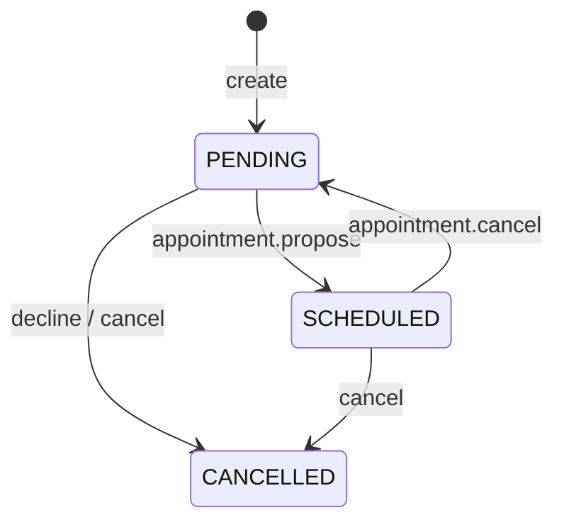

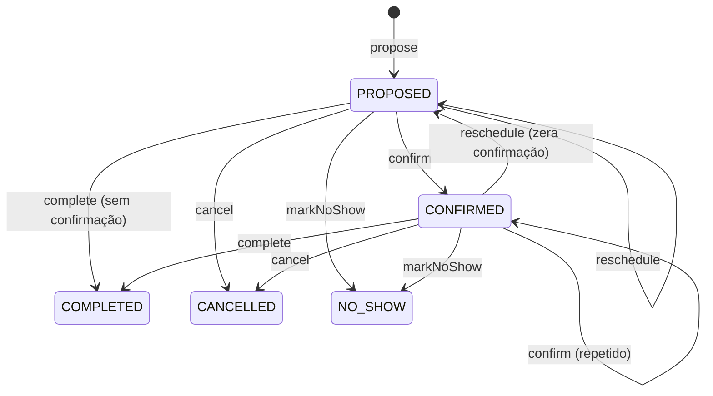

Rotas: `rt/follow-ups.routes.ts` e `rt/appointments.routes.ts`, ambos `requireUserType(SA,CA,MG,OP,MC)` (:71 / :63), todos com `auditLog`, **nenhum com idempotência**. Todos os eventos ficam registrados em `FollowUpEvent`/`AppointmentEvent`.

| Estado | Ação | Próximo | Pré-condições | Efeitos | Idempotência |
|---|---|---|---|---|---|
| — | `followUp.create` `svc/follow-up.service.ts:4` · `POST /` `:73` | PENDING | cliente/moto/revisão coerentes | — | nenhuma |
| qualquer | `logContact :136` · `/:id/contact :91` | inalterado | existe | evento CONTACT_ATTEMPTED | nenhuma |
| PENDING | `recordAcceptance :157` · `/:id/accept :101` | inalterado | PENDING (fora da tx) | evento | nenhuma |
| PENDING | `decline :169` · `/:id/decline :114` | CANCELLED | PENDING (fora da tx) | evento | nenhuma |
| ≠ CANCELLED | `cancel :184` · `/:id/cancel :124` | CANCELLED | ≠ CANCELLED | evento; **agendamento vinculado não é tocado** | nenhuma |
| — | `appointment.propose` `svc/appointment.service.ts:9` · `POST /` `:65` | PROPOSED (+ follow-up SCHEDULED) | follow-up ≠ CANCELLED; sem Appointment prévio | evento | `Appointment.followUpId @unique` |
| PROPOSED/CONFIRMED | `confirm :140`, `reschedule :156`, `cancel :180`, `complete :197`, `markNoShow :208` · `:86`, `:96`, `:109`, `:119`, `:129` | ver diagrama | `assertActive` (fora da tx, :124-133) | cancel: follow-up→PENDING | nenhuma (`update` sem condição) |

**Lacunas**
- **[LACUNA] Follow-up preso em PENDING depois que o agendamento é cancelado.** O cancelamento devolve o follow-up para PENDING (:187-191), mas `propose` recusa porque já existe um Appointment para aquele `followUpId` (:46-49; `@unique` em `schema.prisma:1888`), e o agendamento CANCELLED é terminal para `reschedule`.
- **[LACUNA]** Cancelar um follow-up SCHEDULED deixa o Appointment ativo (PROPOSED/CONFIRMED).
- **[LACUNA]** `assertActive` roda fora da tx: `cancel` × `complete` concorrentes reescrevem um estado terminal e gravam os dois eventos.
- **[DECISÃO NECESSÁRIA]** `complete` a partir de PROPOSED, sem confirmação do cliente, contraria a regra do próprio schema (`:1878-1883`). `markNoShow` não verifica se `scheduledAt` já passou. `complete` não fecha o follow-up (fica SCHEDULED para sempre) e não cria revisão nem OS.
- **[LACUNA]** `FollowUpService.markScheduled`/`revertToPending` (:209, :217) são código morto (sem chamador).

---

## 11. Documento fiscal (`FiscalDocumentStatus`: DRAFT, PENDING, AUTHORIZED, REJECTED, CANCELLED, CONTINGENCY)

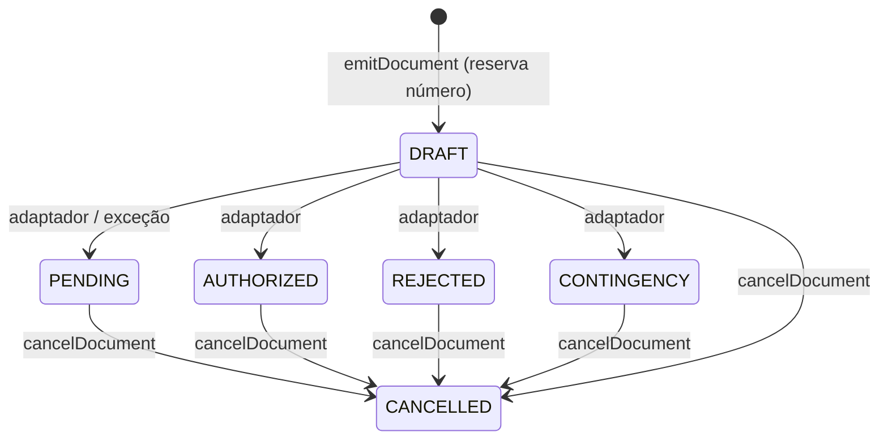

| Estado | Ação | Próximo | Perfil | Pré-condições | Efeitos | Auditoria | Idempotência |
|---|---|---|---|---|---|---|---|
| — | `emitDocument` `svc/fiscal.service.ts:178` · `POST /fiscal/documents` `rt/fiscal.routes.ts:77` | resultado do adaptador | SA,CA,MG,OP (:22) | venda da filial; nenhum doc AUTHORIZED/PENDING/CONTINGENCY para a venda (**fora da tx, exclui DRAFT**, :184-189) | `nfceNextNumber + 1`; XML gravado | CREATE/FiscalDocument | `@@unique([companyId, branchId, documentType, series, number])` + retry |
| ≠ CANCELLED | `cancelDocument` `:318` · `POST /documents/:id/cancel` `:134` | resultado do adaptador (pode continuar o mesmo) | SA,CA,MG,OP | motivo; re-checa ≠ CANCELLED sob `FOR UPDATE` (:363-369) | — | UPDATE | `FOR UPDATE` + releitura |

**Lacunas**
- **[LACUNA] Emissão duplicada para a mesma venda:** a checagem de "documento ativo" roda fora da tx, não tem unique por `saleId` e ignora DRAFT (:185). Duas chamadas concorrentes (sem `idem()` na rota) geram duas NFC-e com números diferentes.
- **[LACUNA]** `emitDocument` não checa o status da venda: emite para venda CANCELLED, RETURNED ou PENDING (:179).
- **[LACUNA]** Não existe transição PENDING/CONTINGENCY→AUTHORIZED (sem retry nem consulta). Um DRAFT fica órfão se o processo cair entre `create` (:216) e `update` (:295).
- **[DECISÃO NECESSÁRIA]** Cancelar documento fiscal não exige gerência. Cancelar a venda não cancela o documento, e vice-versa.

---

## 12. Ativação de dispositivo / Device / Licença

`ActivationStatus`: PENDING, APPROVED, REJECTED. `DeviceStatus`: PENDING, ACTIVE, BLOCKED, REVOKED. `LicenseStatus`: PENDING_APPROVAL, ACTIVE, SUSPENDED, EXPIRED, CANCELLED.

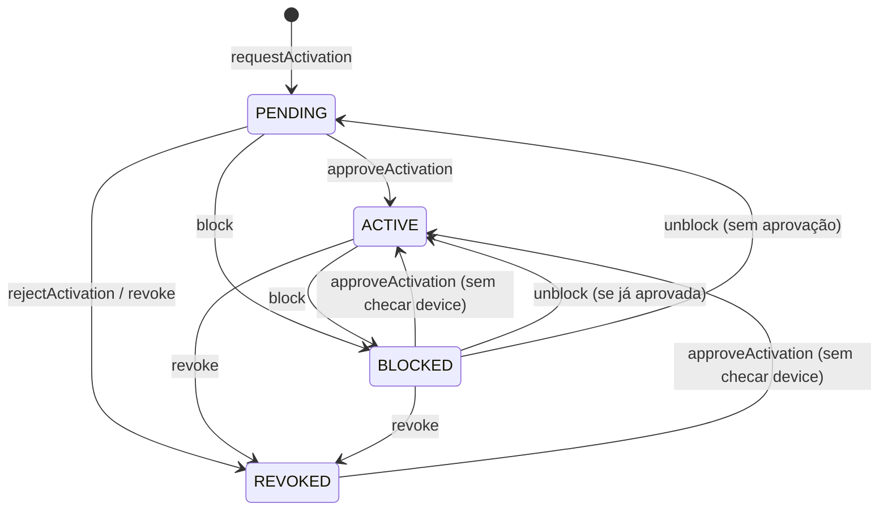

| Estado | Ação | Próximo | Perfil | Pré-condições | Efeitos | Auditoria | Idempotência |
|---|---|---|---|---|---|---|---|
| — | `requestActivation` `svc/activation.service.ts:19` · `POST /activations/request` `rt/activation.routes.ts:24` | Activation PENDING + Device PENDING | qualquer autenticado da empresa da licença | licença ACTIVE; devices PENDING/ACTIVE/BLOCKED < `maxDevices` (fora da tx, :43-54) | — | **nenhuma** | `activationCode @unique` |
| Activation PENDING | `approveActivation` `:104` · `:84` | APPROVED + Device ACTIVE | SA | activation PENDING (fora da tx); **não** checa device nem licença | credencial assinada | UPDATE/Activation | **nenhuma** |
| Activation PENDING | `rejectActivation` `:146` · `:101` | REJECTED + Device REVOKED | SA | idem | — | UPDATE/Activation | nenhuma |
| ≠ REVOKED | `blockDevice` `:179` · `:164` | BLOCKED | SA | ≠ REVOKED | — | UPDATE/Device | nenhuma |
| BLOCKED | `unblockDevice` `:194` · `:182` | ACTIVE/PENDING | SA | = BLOCKED | — | UPDATE/Device | nenhuma |
| qualquer | `revokeDevice` `:220` · `:199` | REVOKED | SA | nenhuma | — | DELETE/Device | nenhuma |
| licença qualquer | `approve/suspend/reactivate/cancel` `svc/license.service.ts:87/108/118/128` · `rt/license.routes.ts:89/111/124/137` | ACTIVE/SUSPENDED/ACTIVE/CANCELLED | SA | **nenhuma** | — | LICENSE_APPROVED / LICENSE_SUSPENDED / UPDATE / UPDATE | nenhuma |

**Lacunas**
- **[LACUNA] Dispositivo REVOKED ou BLOCKED volta a ACTIVE** se a Activation dele ainda estiver PENDING: `revokeDevice`/`blockDevice` não tocam a Activation, e `approveActivation` faz `device.update → ACTIVE` sem checar o estado do device (:126-129). A licença também não é re-checada na aprovação (SUSPENDED/CANCELLED). Reativar um REVOKED ainda fura `maxDevices`, porque a vaga foi liberada na revogação (:43-47).
- **[LACUNA]** `approve` × `reject` concorrentes: sem guarda, a Activation e o Device podem terminar em estados contraditórios.
- **[LACUNA]** Licença sem nenhuma checagem de estado (CANCELLED→ACTIVE via `approve`/`reactivate`). `EXPIRED` nunca é atribuído em código.
- **[DECISÃO NECESSÁRIA]** Os valores `DEVICE_ACTIVATED`/`DEVICE_BLOCKED` de `AuditAction` existem, mas as rotas gravam UPDATE/DELETE.

---

## 13. Enums sem escritor em código

- `QuoteStatus.EXPIRED` (D2), `PurchaseOrderStatus.SENT`, `InventoryStatus.DRAFT`, `LicenseStatus.EXPIRED`: nunca atribuídos.
- `TEFPaymentStatus` / model `TefPayment`: nenhum `tefPayment.*` nos services, ou seja, máquina inexistente em runtime.
- `CashMovementType.CLOSING` é gravado, mas `closeCashRegister` ignora esse tipo no cálculo (`default`, `svc/cash-register.service.ts:133-134`). Correto, só registrado aqui.

## Devolução — regra de rateio do estorno (definida em 2026-09-25)

Base = valor **efetivamente pago** (pagamentos APPROVED), nunca o preço de tabela.

- Fator da venda: `fator = pago ÷ Σ totalPrice` das linhas (`totalPrice` já inclui o desconto do item; o fator rateia o desconto da venda na proporção do valor líquido de cada linha).
- Estornado acumulado: `f(estado) = min(pago, arred2(Σ qtdDevolvida/qtd × totalPrice × fator))`; se todas as linhas foram devolvidas, `f = pago` exatamente.
- Cada devolução estorna `f(depois) − f(antes)`; o cancelamento estorna `pago − f(atual)`. Soma dos estornos = `f(final)` ≤ pago; devolução total fecha em centavos (dízimas absorvidas na última).
- Estoque: o cancelamento só repõe `qtd − qtdDevolvida`.
- Implementação: `apps/api/src/services/sale-refund.ts` (`refundedValue`), usada por `returnSale`/`cancelSale`. Testes: `sale-refund.test.ts` (1 item, 2 itens, parcial, total, desconto, múltiplos itens, arredondamento, qualquer ordem) e `sale-reversal-integrity.integration.test.ts`.

## OS — pagamento por estado (definido em 2026-09-25)

| Estado | Pagamento | Motivo |
| --- | --- | --- |
| ENTRADA, DIAGNOSTICO, ORCAMENTO, APROVACAO, EXECUCAO | ❌ | total ainda muda (itens/mão de obra); comissão congelaria valor provisório |
| **PRONTO, ENTREGA** | ✅ | conclusão técnica: total final; a UI cobra ao encerrar (ENTREGA → ENCERRADA exige pagamento) |
| ENCERRADA | ❌ | já é o pós-pagamento |
| CANCELADA | ❌ | nunca |

Pré-condição: `isPaid = false` (updateMany atômico com o status no WHERE). Efeitos na mesma transação: conta a receber PAGA (mão de obra + peças − desconto), comissão do mecânico sobre a mão de obra (se houver regra ativa), auditoria (`POST /service-orders/:id/payment`). Estoque: nenhum efeito (peças baixadas na EXECUCAO). Permissão: `finance:pay`. Teste: `service-order-payment-states.integration.test.ts` (os 9 estados).

## Atualização 2026-09-26/27

As linhas e marcações acima são de 2026-09-24/25. Mudanças desde então (resumo; regra completa em
[BUSINESS_RULES](../BUSINESS_RULES.md)):

**§2 Pagamento — aprovação tardia em venda cancelada/devolvida.** O `[DECISÃO NECESSÁRIA]` "Aprovação tardia…" ganhou
tratamento técnico: `settlePayment` trava a venda; se ela está CANCELLED/RETURNED, o pagamento vai PENDING → **APPROVED**
com nota `[EXCEÇÃO]`, a venda e o caixa não mudam e nasce uma `payment_exception` (`APPROVED_ON_CLOSED_SALE`, uma por
pagamento). Tratamento: `POST /payments/exceptions/:id/resolve` (`REFUND` só conclui com o provedor confirmando;
`MANUAL` com justificativa). `cancelPayment`/`refundPayment` recusam pagamento com exceção (409 `PAYMENT_IN_EXCEPTION`),
conferido dentro da transação da guarda. A **política comercial** continua `[DECISÃO NECESSÁRIA]`. A reconciliação já
tinha guarda atômica (PENDING → final) desde 2026-09-25. Prova: `payment-exceptions.integration.test.ts`.

**§8 Estoque.** O saldo é calculado no banco por `svc/stock-ledger.ts` (mesma regra; `INVENTORY` absoluto; ordem
`createdAt, id`); `getBalance`, `getProductStock`, relatório, painel e jobs usam o livro sem trazer o histórico ao Node.
Prova: `stock-ledger.integration.test.ts`.

**§10 Agendamento / follow-up** (commit 2e7a4fa):
- `confirm` só a partir de PROPOSED (CONFIRMED → CONFIRMED não existe mais) e exige `channel` + `confirmedByName`.
- Todas as transições usam guarda atômica (`updateMany where status in …` + contagem → 409): ~~`assertActive` fora da tx~~.
- ~~Follow-up preso em PENDING depois do cancelamento~~: novo `propose` substitui o agendamento encerrado (evento
  "Substitui o agendamento X").
- ~~Cancelar follow-up deixa o agendamento ativo~~: agora cancela o agendamento ativo e registra o evento.
- ~~`markNoShow` antes do horário~~: recusado (`NO_SHOW_BEFORE_SLOT`).
- ~~`markScheduled`/`revertToPending` sem chamador~~: removidos.
- Agendamento precisa ser do mesmo cliente e moto do follow-up (`FOLLOW_UP_MISMATCH`).
- Seguem `[DECISÃO NECESSÁRIA]`: `complete` a partir de PROPOSED; `complete` não fecha o follow-up; capacidade/duplo
  agendamento no mesmo horário.
- Prova: `agenda-rules.integration.test.ts`.

**Revisão.** Próxima data sem estourar o mês (`addMonthsClamped`); `performedAt` válido e no máximo +24 h; campo
`recommendations`.
